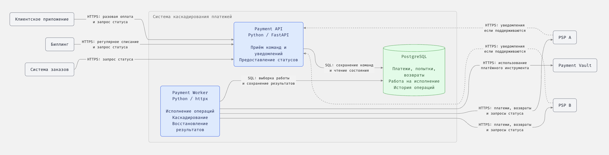

## Введение

### Задача: Спроектировать систему каскадирования платежей (можно использовать любого тестового провайдера)

### Термины:

- PSP (Payment Service Provider) — платежный провайдер

### Дополнительные исходные данные с учетом описания вакансии:

— так как продукт международный, потенциально необходимо поддерживать
разные валюты, регионы и PSP
— несколько видов платежей: подписки (то есть повторяющиеся платежи), разовые подарки
— масштаб продукта: до 100000 одновременных пользователей (но не платежей)

### Функциональные требования (FR-**)

1. обработка карточных платежей через несколько независимых PSP
2. поддержка последовательных попыток платежей через различные PSP (когда переключение безопасно и разрешено)
3. Повторные запросы клиента и конкурентная обработка одного платежа не должны создавать дополнительные денежные операции.
4. в случае неизвестного ответа от PSP нужно выяснить более понятный статус и судьбу изначальной операции, НЕ ЗАПУСКАЯ НОВУЮ ДЕНЕЖНУЮ ПОПЫТКУ на тот же или иной PSP
5. отдавать внешней системе (например, системе заказов) текущий статус платежа (в том числе незавершенную обработку)
6. логировать историю запросов и попыток платежа, а также основания для перехода на другой PSP
7. выявлять и передавать на сверку и ручную обработку длительно неразрешаемые и
   нестандартные операции
8. Отмена платежа до начала взаимодействия с PSP останавливает обработку без выполнения денежной операции. После начала взаимодействия с PSP отмена не гарантируется: сначала необходимо выяснить результат исходной операции. После успешного списания используется возврат.
9. Обработка возвратов: нужно определить контракт возврата после успешной оплаты и получение его результата

### Нефункциональные требования (стандартный набор категорий) (NFR-***)

1. Корректность
   таймаут не считается отказом.
   UNKNOWN результат от PSP блокирует небезопасную следующую попытку.
2. Надёжность
   После перезапуска система не теряет незавершённые операции и продолжает восстановление.
3. Доступность
   Сбой одного PSP не должен останавливать платежи, которые можно безопасно направить другому.
4. Безопасность
   Защищены карточные данные, секреты и доступ к операциям; проверяется подлинность сообщений PSP.
5. Производительность (опционально)
   Время ответа ограничено, как и нагрузка на PSP; численно параметы пока не определены.
6. Наблюдаемость
   Возможно проследить платёж через все статусы (со временем) и попытки платежа, отдельно обнаружить и пометить зависшие операции и ошибки восстановления.
7. Развитие
   Добавление нового PSP не требует переписывания уже созданных правил корректности платежей
8. Идемпотентность
   Повторы запросов не должны создавать повторные денежные эффекты.

## Архитектурный контекст

### Назначение системы

Система управляет выполнением карточного платежа через несколько PSP, последовательно переключаясь между ними только при подтверждённой безопасности следующей попытки. Предоставляет текущий статус платежа и обеспечивает возможность восстановления незавершённых операций.

### Участники и внешние системы

Ниже перечислены участники и внешние системы, их ответственность и взаимодействие с системой каскадирования платежей.

1. Клиентское приложение
   Инициирует разовый платёж и получает его текущий статус.
2. Биллинг
   Управляет расписанием подписок и инициирует очередное списание. Получает текущий статус платежа.
3. Payment Vault
   Обеспечивает независимую от отдельного PSP токенизацию платёжных данных. Позволяет использовать сохранённый платёжный инструмент у выбранных PSP, в том числе для повторных списаний без участия пользователя.
4. PSP
   Исполняет денежные операции. Конкретные возможности получения статусов, уведомлений, идемпотентности и возвратов требуют уточнения для выбранных провайдеров.
5. Внешняя система заказов
   Использует результат платежа для принятия решения о предоставлении цифрового товара.
6. Оператор
   Разбирает длительно неразрешаемые и нестандартные операции, переданные на сверку и ручную обработку.

### Границы ответственности

Внутри системы каскадирования:

- исполнение команд на разовую оплату и очередное списание;
- управление платежом и историей его попыток;
- выбор PSP и переключение между PSP только при подтверждённой безопасности следующей попытки;
- защита от повторных денежных операций при повторах запросов и конкурентной обработке;
- получение и уточнение результатов PSP, восстановление незавершённых операций;
- предоставление текущего статуса платежа внешним системам;
- остановка ещё не начатой обработки платежа и выполнение возвратов после успешного списания;
- ведение истории операций и выделение случаев для сверки и ручного разбора.

За пределами системы:

- управление заказами и предоставление цифровых товаров передаётся внешней системы заказов;
- управление жизненным циклом подписки, расписанием и формированием команд на очередное списание передаётся в ответственность биллинг-системы;
- хранение и токенизация данных карточек — ответственность Payment Vault;
- непосредственное проведение денежных операций — ответственность PSP.

### Основные взаимодействия

1. Клиентское приложение инициирует разовый платёж; биллинг инициирует очередное списание по подписке.
2. Система использует сохранённый в Payment Vault платёжный инструмент для выполнения операции через выбранный PSP.
3. Система выясняет результат операции через доступные механизмы PSP. Таймаут или неизвестный результат не разрешают новую денежную попытку.
4. Следующий PSP используется только при подтверждённой безопасности и допустимости переключения.
5. Внешние системы получают текущий статус платежа, включая незавершённую обработку. Способ получения результата необходимо определить в контракте взаимодействия.
6. Длительно неразрешаемые и нестандартные операции передаются оператору. Передача на ручную обработку сама по себе не разрешает повторное списание.

### Контейнерная архитектура

## Ограничения и допущения

- Дополнительные исходные данные из описания вакансии являются проектными предположениями, а не подтверждёнными условиями задания.
- Используется одностадийная оплата. Система не предоставляет отдельных команд авторизации и последующего списания.
- Сценарии, требующие дополнительного подтверждения пользователем, не входят в текущий объём решения. Если PSP требует такое подтверждение, это нельзя игнорировать или само по себе считать разрешением на переключение.
- В качестве принятого условия решения Payment Vault позволяет использовать сохранённый платёжный инструмент у выбранных PSP, включая повторные списания без участия пользователя. Токенизация не привязывает систему к одному PSP.
- Отмена ограничена остановкой обработки до начала взаимодействия с PSP. После начала взаимодействия результат исходной операции необходимо выяснить; успешное списание обрабатывается через возврат.
- До 100000 одновременных пользователей не означает столько же одновременных платежей. Частота платежей, пиковая нагрузка и численные ограничения времени ответа пока не определены.
- Гарантии конкретных PSP должны следовать из их контрактов. Они не считаются известными только на основании наличия интеграции.

<!--## Открытые вопросы

1. Какие PSP используются и какие гарантии они предоставляют: идемпотентность денежных операций, получение статуса, уведомления о результате и возвраты?
2. Какие результаты каждого PSP подтверждают безопасность следующей попытки, а какие требуют продолжения выяснения статуса исходной операции?
3. Как система завершает обработку или сообщает результат, если PSP требует дополнительного подтверждения пользователем, не поддерживаемого в текущем объёме решения?
4. Каковы контракт возврата, способ получения его результата и правила обработки неизвестного результата возврата?
5. Как внешние системы получают изменения статуса платежа и кто инициирует отмену или возврат?
6. Каковы ожидаемые частота платежей, пики, ограничения времени ответа и допустимая нагрузка на PSP?-->

## ADR

### ADR-001. Одностадийная оплата

**Статус:** принято.

**Контекст:** цифровые товары предоставляются после подтверждения оплаты. Резервирование средств до выполнения заказа не требуется; срок реализации ограничен.

**Решение:** использовать одностадийную оплату без отдельных команд авторизации и последующего списания.

**Последствия:** сценарии отложенного списания не поддерживаются. Остановка платежа предусмотрена до начала взаимодействия с PSP. После успешного списания обратная операция оформляется возвратом.

### ADR-002. Независимая токенизация через Payment Vault

**Статус:** принято.

**Контекст:** каскадирование и регулярные списания требуют использования сохранённого платёжного инструмента у нескольких PSP без повторного ввода карточных данных пользователем. Токен отдельного PSP не даёт такой гарантии.

**Решение:** использовать независимый Payment Vault, позволяющий применять сохранённый платёжный инструмент у выбранных PSP, включая повторные списания без участия пользователя.

**Последствия:** Payment Vault становится внешней зависимостью платёжного процесса. Набор подключаемых PSP ограничен совместимостью с выбранным Vault. Переносимость платёжного инструмента не отменяет проверку безопасности и допустимости каждой следующей денежной попытки.

### ADR-003. Разделение HTTP API и исполнения платежей

**Статус:** принято.

**Контекст:** выполнение платежа может продолжаться дольше HTTP-запроса и требовать восстановления после сбоя. Обработка HTTP-запросов не должна зависеть от ожидания ответа PSP.

**Решение:** выделить Payment API и Payment Worker в отдельные процессы с разделением ответственности:

- Payment API принимает команды создания платежа, отмены и возврата, проверяет доступ и входные данные, сохраняет команды с защитой от повторных запросов и предоставляет текущие статусы. При необходимости принимает и проверяет подлинность уведомлений PSP. Самостоятельно денежные операции через PSP не выполняет.
- Payment Worker выполняет денежные операции через PSP, взаимодействует с Payment Vault, управляет последовательными попытками, выясняет неизвестные результаты и восстанавливает незавершённую обработку. Выделяет операции для ручного разбора.

**Последствия:** остановка API не прерывает уже сохранённую работу Worker. При остановке Worker API может принимать команды, пока доступны БД и допустима накопленная нагрузка, но исполнение задерживается. Требуется согласованная координация через PostgreSQL. Разделение процессов не требует отдельных микросервисов или репозиториев.

### ADR-004. Передача работы через PostgreSQL без отдельного брокера

**Статус:** принято.

**Контекст:** необходимо надёжно передавать работу от API к Worker и сохранять её после перезапуска. Срок реализации ограничен; потребность в отдельном брокере пока не обоснована.

**Решение:** использовать PostgreSQL для хранения работы и координации её исполнения. Payment API сохраняет принятую команду и необходимость обработки в одной транзакции. Payment Worker выбирает сохранённую работу и фиксирует результаты. Redis и RabbitMQ в текущий состав системы не включаются.

**Обоснование:**

- Атомарность: платёж и необходимость его обработки сохраняются в одной транзакции PostgreSQL. Отдельный брокер потребовал бы согласования записи в БД и публикации сообщения, например через transactional outbox.
- Корректность: брокер не устраняет повторную обработку и неизвестный результат списания. Идемпотентность и восстановление нужны независимо от способа передачи работы.
- Достаточность: сложная маршрутизация и несколько независимых потребителей пока не требуются. Необходимость брокера по нагрузке также не подтверждена.
- Ограниченное время: дополнительная инфраструктура увеличивает объём настройки, эксплуатации и проверки отказов. Приоритет — корректность платежей.

**Последствия:** необходимо реализовать захват работы, восстановление после сбоя и контроль очереди. Опрос создаёт дополнительную нагрузку на PostgreSQL. Восстановление работы не означает автоматического повторения списания: при неизвестном результате выясняется судьба исходной попытки.

**Условия пересмотра:** неприемлемая нагрузка или задержки по результатам измерений, появление независимых потребителей либо требований к сложной маршрутизации.
