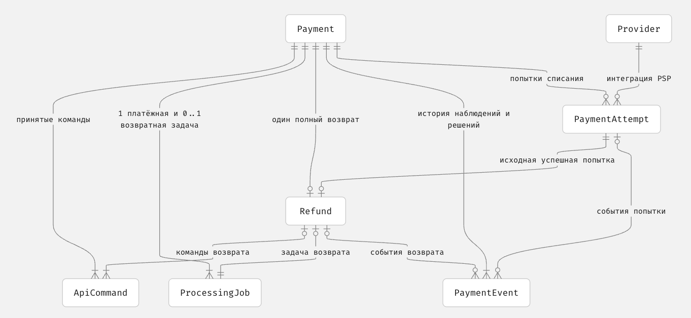
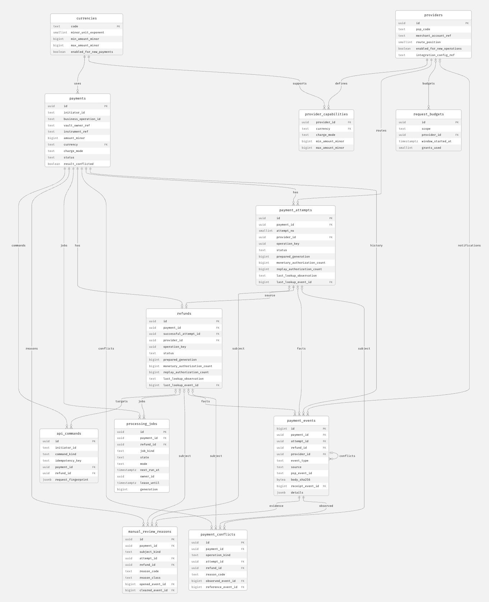
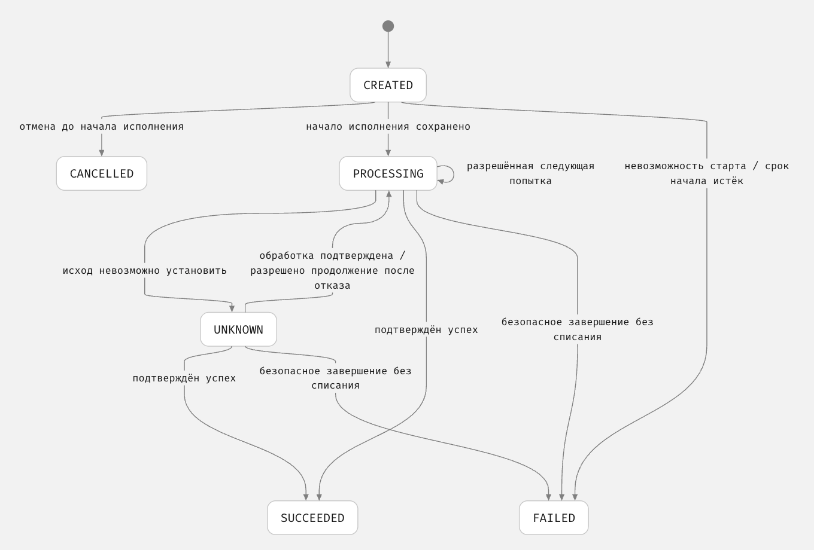
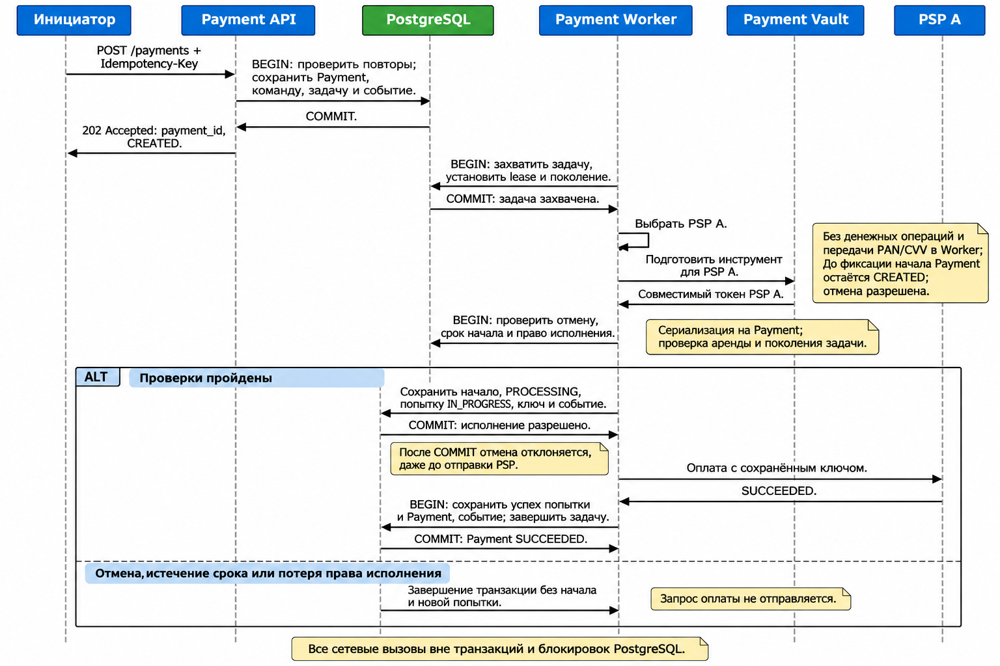

## 1. Введение (Overview)

Задача — спроектировать систему каскадирования платежей. По условиям задания можно использовать любого тестового провайдера.

### Назначение системы

Система выполняет карточный платёж через несколько PSP. Если один провайдер не смог провести оплату, следующий может помочь — но только когда подтверждено, что новая попытка безопасна. Неизвестный результат нельзя считать отказом: сначала нужно выяснить судьбу исходной операции.

Система также предоставляет текущий статус платежа и восстанавливает незавершённые операции после сбоев.

### Термины

- PSP (Payment Service Provider) — платёжный провайдер.

### Контекст из описания вакансии

- Международному продукту потенциально нужна поддержка разных валют, регионов и PSP.
- Предусмотрены подписки с повторяющимися платежами и разовые подарки.
- Масштаб продукта — до 100000 одновременных пользователей, но не платежей.

### Границы ответственности

Внутри системы каскадирования:

- исполнение команд на разовую оплату и очередное списание;
- управление платежом и историей его попыток;
- выбор PSP и переключение между PSP только при подтверждённой безопасности следующей попытки;
- защита от повторных денежных операций при повторах запросов и конкурентной обработке;
- получение и уточнение результатов PSP, восстановление незавершённых операций;
- предоставление текущего статуса платежа внешним системам;
- остановка ещё не начатой обработки платежа и выполнение возвратов после успешного списания;
- ведение истории операций и выделение случаев для сверки и ручного разбора.

За пределами системы:

- управление заказами и предоставление цифровых товаров — ответственность внешней системы заказов;
- управление жизненным циклом подписки, расписанием и формированием команд на очередное списание — ответственность биллинг-системы;
- хранение и токенизация данных карточек — ответственность Payment Vault;
- непосредственное проведение денежных операций — ответственность PSP.

### Ограничения и допущения

- Контекст из описания вакансии использую как проектные предположения, а не как подтверждённые условия задания.
- Используется одностадийная оплата. Система не предоставляет отдельных команд авторизации и последующего списания.
- Сценарии, требующие дополнительного подтверждения пользователем, не входят в текущий объём решения. Если PSP требует такое подтверждение, это нельзя игнорировать или само по себе считать разрешением на переключение.
- В этом решении принято допущение: Payment Vault позволяет использовать сохранённый платёжный инструмент у выбранных PSP, включая повторные списания без участия пользователя. Токенизация не привязывает систему к одному PSP.
- Отмена разрешена только до фиксации начала исполнения в БД. После этой фиксации отмена отклоняется, даже если запрос PSP фактически ещё не отправлен; результат исходной операции необходимо выяснить, а успешное списание обрабатывается через возврат.
- До 100000 одновременных пользователей не означает столько же одновременных платежей. Частота платежей, пиковая нагрузка и численные ограничения времени ответа пока не определены.
- Гарантии конкретных PSP должны следовать из их контрактов. Само наличие интеграции их не подтверждает.
- Для тестового решения я выбрал собственные локальные симуляторы PSP A и PSP B с независимыми состояниями и настройками. Реальные деньги и карточные данные не используются. Такой стенд позволяет проверять управляемые сценарии сбоев (ADR-005), но не подтверждает совместимость с реальными PSP и не заменяет проработку Payment Vault.

<!-- Исторический список вопросов закрыт актуальными главами 5–9 и ADR. Оставшиеся ограничения перечислены в главе 13. -->

## 2. Требования (Requirements)

### Функциональные требования (FR-**)

1. Обработка карточных платежей через несколько независимых PSP.
2. Последовательные попытки платежа через разные PSP, когда переключение безопасно и разрешено.
3. Повторные запросы клиента и конкурентная обработка одного платежа не должны создавать дополнительные денежные операции.
4. При неизвестном результате PSP выяснять статус исходной операции. Новая денежная попытка на том же или другом PSP запрещена.
5. Предоставлять внешней системе, например системе заказов, текущий статус платежа, включая незавершённую обработку.
6. Сохранять историю запросов и попыток платежа, а также основания для перехода на другой PSP.
7. Выявлять и передавать на сверку и ручную обработку длительно неразрешаемые и нестандартные операции.
8. Отмена платежа, принятая до фиксации начала исполнения в БД, останавливает обработку без выполнения денежной операции. Отмена и фиксация начала сериализуются на Payment и взаимно исключаются. После фиксации начала отмена отклоняется, даже если запрос PSP ещё не отправлен; сначала необходимо выяснить результат исходной операции. После успешного списания используется возврат.
9. Выполнение одного полного возврата подтверждённого успешного платежа через исходный PSP. Повторы команд не создают новых возвратов; при неизвестном результате выясняется судьба исходной операции возврата. Частичные возвраты не входят в текущий объём.

### Нефункциональные требования (NFR-***)

1. **Корректность.** Таймаут не считается отказом. Результат UNKNOWN от PSP блокирует небезопасную следующую попытку.
2. **Надёжность.** После перезапуска система не теряет незавершённые операции и продолжает восстановление.
3. **Доступность.** Сбой одного PSP не должен останавливать платежи, которые можно безопасно направить другому.
4. **Безопасность.** Защищены карточные данные, секреты и доступ к операциям; проверяется подлинность сообщений PSP.
5. **Производительность (опционально).** Время ответа и нагрузка на PSP ограничены; численные параметры пока не определены.
6. **Наблюдаемость.** Можно проследить все статусы и попытки платежа с временными отметками, обнаружить и пометить зависшие операции и ошибки восстановления.
7. **Развитие.** Добавление нового PSP не требует переписывать существующие правила корректности платежей.
8. **Идемпотентность.** Повторы запросов не должны создавать повторные денежные эффекты.

## 3. Архитектура системы (System Architecture)

> - C4 Level 1 — System Context Diagram.
> - C4 Level 2 — Container Diagram.
> - Основные компоненты и их ответственность.
> - Выбранный технологический стек и обоснование.

### Участники и внешние системы

1. Клиентское приложение
   Инициирует разовый платёж и получает его текущий статус.
2. Биллинг
   Управляет расписанием подписок и инициирует очередное списание. Получает текущий статус платежа.
3. Payment Vault
   Обеспечивает независимую от отдельного PSP токенизацию платёжных данных. Позволяет использовать сохранённый платёжный инструмент у выбранных PSP, в том числе для повторных списаний без участия пользователя.
4. PSP
   Исполняет денежные операции. Для локальных PSP A и B применяются гарантии и нормализация результатов из глав 6–8; гарантии реальных провайдеров требуют отдельной проверки.
5. Внешняя система заказов
   Использует результат платежа для принятия решения о предоставлении цифрового товара.
6. Оператор
   Разбирает длительно неразрешаемые и нестандартные операции, переданные на сверку и ручную обработку.

### Основные взаимодействия

1. Клиентское приложение инициирует разовый платёж; биллинг инициирует очередное списание по подписке.
2. Система использует сохранённый в Payment Vault платёжный инструмент для выполнения операции через выбранный PSP.
3. Система выясняет результат операции через доступные механизмы PSP. Таймаут или неизвестный результат не разрешают новую денежную попытку.
4. Следующий PSP используется только при подтверждённой безопасности и допустимости переключения.
5. Внешние системы получают текущий статус платежа, включая незавершённую обработку, через GET из главы 7.
6. Длительно неразрешаемые и нестандартные операции передаются оператору. В текущем стенде оператор только читает и разбирает информацию; передача на ручную обработку сама по себе не разрешает повторное списание.

### Контейнерная архитектура

### Дальнейшая проработка компонентов

Начать с небольшого числа модулей внутри существующих Payment API и Payment Worker. Подробный состав компонентов пока не утверждён; отдельный сервис на каждую обязанность не требуется.

## 4. Модель данных (Data Model)

Модель описывает данные системы каскадирования в PostgreSQL. Состояние операций самих PSP хранится независимо, в симуляторах. Точные статусы и протокол конкурентного исполнения заданы в главах 5 и 8. Здесь описана физическая схема основной БД, но это не означает, что SQL-миграции и производственные настройки уже применены.

### Сущности и ответственность

| Сущность       | Назначение                                                                     | Основные данные                                                                                                                                                                                                                                       |
| -------------- | ------------------------------------------------------------------------------ | ----------------------------------------------------------------------------------------------------------------------------------------------------------------------------------------------------------------------------------------------------- |
| Payment        | Одно бизнес-намерение списания                                                 | Инициатор, внешний идентификатор бизнес-операции, сумма в минимальных единицах валюты, валюта, режим списания, ссылка Vault, результат списания, отметки начала исполнения и отмены, производный ручной разбор и sticky-признак конфликта результатов |
| PaymentAttempt | Одна логическая операция списания у PSP                                        | Платёж, Provider, номер попытки, неизменный ключ PSP, необязательный идентификатор операции PSP, результат, окончательность и причина отказа                                                                                                          |
| Provider       | Настроенная интеграция конкретного PSP с конкретной учётной записью получателя | Код PSP, идентификатор учётной записи, доступность для новых операций и несекретные параметры интеграции                                                                                                                                              |
| Refund         | Единственный полный возврат платежа                                            | Платёж, исходная успешная PaymentAttempt, собственный ключ PSP, необязательный идентификатор возврата PSP, результат                                                                                                                                  |
| ApiCommand     | Дедупликация принятых внешних команд                                           | Инициатор, вид команды, ключ идемпотентности, существенные параметры для сравнения, ссылка на Payment и при необходимости Refund, время и результат принятия                                                                                          |
| ProcessingJob  | Сохранённая необходимость обработки платежа или возврата                       | Цель и вид обработки, техническое состояние, время следующего запуска, владелец и срок аренды, поколение захвата, счётчик запусков и последняя техническая ошибка                                                                                     |
| PaymentEvent   | Неизменяемая история наблюдений и решений                                      | Платёж, необязательные ссылки на попытку и возврат, Provider и event_id для входящего PSP-события, хеш тела, источник, тип события, время приёма, сведения о результате и основании решения                                                           |

Физическая схема также содержит справочники и проекции `currencies`, `provider_capabilities`, `manual_review_reasons`, `payment_conflicts` и `request_budgets`. Они не добавляют новых логических денежных сущностей: первые две хранят конфигурацию допуска, следующие две — производные причины/аномалии, последняя — общий технический бюджет исходящих запросов.

Каждая сущность имеет внутренний идентификатор; для изменяемых записей сохраняются временные отметки создания и изменения. Повторная отправка исходного запроса PSP остаётся внутри той же PaymentAttempt. Число запусков ProcessingJob не является числом денежных попыток.

Provider сохраняет идентичность PSP и учётной записи для восстановления старых операций; отключение новых платежей не запрещает выяснение их результата и возврат. Сумма и валюта Refund следуют из неизменяемого Payment, а PSP — из исходной успешной попытки: отдельные редактируемые значения не вводятся.

ApiCommand не заменяет HTTP access log. PaymentEvent дополняет текущие состояния, но не требует восстанавливать систему проигрыванием событий. История и данные для восстановления не содержат карточных реквизитов, секретов и неочищенных HTTP-запросов. Существенные параметры исходной операции должны восстанавливаться из сохранённых данных без изменений; ключ PSP сохраняется до первой возможной отправки.

### Логические связи

Связанные попытки, возвраты, команды, задачи и события принадлежат одному и тому же Payment. Для каждого принятого платежа существуют как минимум команда создания и начальное событие, а также одна переиспользуемая платёжная задача. Если принят возврат, он имеет собственные команду, начальное событие и задачу; задача возврата также ссылается на исходный Payment. Поэтому у платежа одна платёжная и не более одной возвратной задачи, а не произвольное число задач. Обязательное создание дочерних записей обеспечивается транзакцией, а не одним внешним ключом.

### Ограничения целостности

- Уникальна пара «инициатор + бизнес-операция» для Payment и тройка «инициатор + вид команды + ключ идемпотентности» для ApiCommand. Смена ключа запроса не обходит идентичность бизнес-операции; изменённые существенные параметры при повторе отклоняются.
- Сумма положительна и целочисленна, валюта поддерживается явно. Сумма, валюта, инструмент, режим списания и бизнес-идентичность Payment неизменяемы после принятия. Фиксации отмены и начала исполнения взаимно исключаются.
- Номер PaymentAttempt уникален внутри Payment, Provider используется не более одного раза на Payment, а локально незавершённая попытка не дублируется. Ключ денежной операции уникален в области Provider и вида операции; Provider уже включает учётную запись получателя. Идентификатор PSP может отсутствовать и не считается глобально уникальным.
- На Payment допускается не более одного Refund. Его исходная попытка принадлежит тому же платежу и имеет подтверждённый успех; результат списания и результат возврата учитываются отдельно.
- На Payment существует одна платёжная ProcessingJob, на Refund — одна задача возврата. Ссылки и обязательность полей соответствуют виду задачи и команды.
- Для принятого PSP-уведомления уникальна пара «Provider + event_id» среди записей приёма уведомлений; отдельное событие конфликта может ссылаться на исходную запись и сохранять другой хеш того же event_id. Повтор уже сохранённого конфликтного тела для того же Payment дедуплицируется, а другое тело сохраняется. Противоречивые наблюдения не удаляются и устанавливают признак конфликта.

Первичные и внешние ключи, уникальность и построчные проверки защищают структуру данных, включая не более двух попыток и не более одной локально незавершённой попытки на Payment. Проверка успеха исходной попытки, безопасного переключения и допустимости возврата выполняется по протоколу главы 8; declarative constraints не заменяют проверку предыдущих результатов.

Схема не должна мешать сохранить фактическое наблюдение противоречивых результатов или второго успеха при нарушении контракта PSP. Такие факты сохраняются, блокируют новые операции и передаются на разбор. Истечение аренды задачи или передача оператору не доказывают отсутствие списания и не разрешают новую попытку.

### Физический профиль PostgreSQL

Целевой профиль стенда — PostgreSQL 18 без обязательных расширений. Имена таблиц и колонок используют `snake_case`, таблицы — множественное число. Идентификаторы доменных записей — `uuid`, генерируются приложением до транзакции; `payment_events.id` — `bigint GENERATED ALWAYS AS IDENTITY` для устойчивого порядка истории. UUID не являются credentials.

Время хранится как `timestamptz`; проверки срока аренды после блокировки используют актуальное `clock_timestamp()`, а не время начала транзакции. Суммы хранятся как положительный `bigint` в минимальных единицах валюты. Это технический предел типа, а не утверждённый бизнес-диапазон; дробный ввод отклоняется до приведения к `bigint`, чтобы SQL-cast не округлял его. Строковые идентификаторы, ключи и нормализованные коды сравниваются точно, с ограничением размера и без молчаливой нормализации; токен Vault не индексируется.

Закрытые наборы статусов, видов и причин задаются `text` с именованными `CHECK`, а не PostgreSQL `enum`: это позволяет добавлять новую версию схемы явно. Причины содержат только безопасные нормализованные коды.

Все внешние ключи финансовых записей используют `ON DELETE RESTRICT` и `ON UPDATE RESTRICT`; каскадное удаление истории не допускается. Неизменяемость ключевых полей защищается правами и узкими триггерами будущего DDL, а финансовые переходы — протоколом главы 8, не CHECK.

AR-05 остаётся открытым: справочник валют, бизнес-минимумы/максимумы и строки совместимости A/B должны быть заполнены отдельным решением. Схема ниже предусматривает хранение этих данных и запрещает приём без явного профиля. Конкретные значения пока не заданы.

### Физические таблицы и поля

Ниже перечислены обязательные поля. `?` означает nullable; у изменяемых таблиц присутствуют `created_at` и `updated_at` типа `timestamptz` с временем БД. Составные FK с `payment_id` не позволяют связать дочернюю запись с чужим Payment.

#### Справочники интеграций

`currencies`:

- `code text PRIMARY KEY` — ровно три ASCII-заглавные буквы;
- `minor_unit_exponent smallint NOT NULL`, `min_amount_minor bigint NOT NULL`, `max_amount_minor bigint NOT NULL` — `0 <= exponent`, `0 < min <= max`;
- `enabled_for_new_payments boolean NOT NULL DEFAULT false`, timestamps.

Код и exponent не переназначаются после использования. Отключение действует только на новые Payment; уже принятые операции не становятся недействительными.

`providers`:

- `id uuid PRIMARY KEY`, `psp_code text NOT NULL`, `merchant_account_ref text NOT NULL`;
- `route_position smallint NOT NULL UNIQUE` для текущей цепочки A → B;
- `enabled_for_new_operations boolean NOT NULL DEFAULT false`;
- `integration_config_ref text NOT NULL` — неизменная ссылка на доверенную несекретную интеграцию endpoint/Adapter, не credentials;
- timestamps.

UNIQUE `(psp_code, merchant_account_ref)`. Provider не удаляется и не переназначается. Ротация credentials не меняет его идентичность; смена endpoint/integration config требует отдельного согласования, чтобы старый replay не был перенаправлен в другую интеграцию.

`provider_capabilities`:

- `provider_id uuid NOT NULL REFERENCES providers(id)`, `currency text NOT NULL REFERENCES currencies(code)`, `charge_mode text NOT NULL`;
- `min_amount_minor bigint NOT NULL`, `max_amount_minor bigint NOT NULL`, timestamps;
- PRIMARY KEY `(provider_id, currency, charge_mode)`, `charge_mode IN ('ONE_TIME','RECURRING')`, `0 < min <= max`.

Отсутствующая комбинация несовместима. Изменение capability применяется к новым Attempt, не к replay/lookup существующей операции. Заполнение строк и конкретные лимиты относятся к AR-05.

#### Денежный агрегат

`payments`:

- `id uuid PRIMARY KEY`, `initiator_id text NOT NULL`, `business_operation_id text NOT NULL`;
- `vault_owner_ref text NOT NULL`, `instrument_ref text NOT NULL`;
- `amount_minor bigint NOT NULL`, `currency text NOT NULL REFERENCES currencies(code)`, `charge_mode text NOT NULL`;
- `status text NOT NULL DEFAULT 'CREATED'`, `status_reason text?`;
- `accepted_at timestamptz NOT NULL`, `start_deadline_at timestamptz NOT NULL`;
- `execution_started_at timestamptz?`, `cancelled_at timestamptz?`, `finalized_at timestamptz?`, `review_due_at timestamptz?`;
- `result_conflicted boolean NOT NULL DEFAULT false`, timestamps.

UNIQUE `(initiator_id, business_operation_id)`. CHECK ограничивает status значениями `CREATED`, `PROCESSING`, `UNKNOWN`, `SUCCEEDED`, `FAILED`, `CANCELLED`, режим — `ONE_TIME`/`RECURRING`, сумму — положительным bigint. `CREATED` не имеет начала/отмены; `CANCELLED` требует отмену без начала; `PROCESSING/UNKNOWN/SUCCEEDED` требуют начало; `finalized_at` допустим только у обычных финальных статусов. Начало и отмена взаимоисключаются. `result_conflicted` только устанавливается в true и не снимается в текущем стенде.

`manual_review.required/reason` не дублируются в Payment: они вычисляются по активным строкам `manual_review_reasons`; `conflicts` — по `payment_conflicts`.

`payment_attempts`:

- `id uuid PRIMARY KEY`, `payment_id uuid NOT NULL REFERENCES payments(id)`, `attempt_no smallint NOT NULL`, `provider_id uuid NOT NULL REFERENCES providers(id)`;
- `operation_key uuid NOT NULL`, `payment_token text NOT NULL`, `status text NOT NULL DEFAULT 'IN_PROGRESS'`, `status_reason text?`;
- `provider_operation_id text?`, `prepared_generation bigint NOT NULL`, `recovery_step bigint NOT NULL DEFAULT 0`;
- `monetary_authorization_count bigint NOT NULL DEFAULT 0`, `replay_authorization_count bigint NOT NULL DEFAULT 0`;
- `last_authorized_generation bigint?`, `last_authorized_at timestamptz?`, `last_replay_authorized_at timestamptz?`;
- `last_lookup_observation text?`, `last_lookup_generation bigint?`, `last_lookup_event_id bigint?`, `last_lookup_at timestamptz?`;
- `finalized_at timestamptz?`, timestamps.

UNIQUE `(payment_id, attempt_no)`, `(payment_id, provider_id)`, `(provider_id, operation_key)`, `(payment_id, id)` для составных FK. Дополнительный partial UNIQUE `(payment_id) WHERE status IN ('IN_PROGRESS','UNKNOWN')` защищает от двух локальных незавершённых исполнений, но не отбрасывает поздний второй успех. `status` — `IN_PROGRESS/UNKNOWN/SUCCEEDED/FAILED`; ACTION_REQUIRED хранится как наблюдение/причина. Нет UNIQUE «один SUCCEEDED на Payment»: противоречивый второй успех обязан сохраниться.

Ключ, Provider, token, generation подготовки и существенные параметры Attempt неизменяемы. Replay восстанавливает запрос из этих сохранённых полей и неизменных параметров Payment/Provider; изменяемый JSON-шаблон не является источником денежного запроса.

`refunds`:

- `id uuid PRIMARY KEY`, `payment_id uuid NOT NULL UNIQUE REFERENCES payments(id)`;
- `successful_attempt_id uuid NOT NULL`, `provider_id uuid NOT NULL`, составной FK `(payment_id, successful_attempt_id, provider_id)` → `payment_attempts(payment_id,id,provider_id)`;
- `operation_key uuid NOT NULL`, `status text NOT NULL DEFAULT 'CREATED'`, `status_reason text?`, `provider_operation_id text?`;
- `accepted_at timestamptz NOT NULL`, `execution_started_at timestamptz?`, `finalized_at timestamptz?`;
- `start_review_due_at timestamptz NOT NULL`, `execution_review_due_at timestamptz?`, `prepared_generation bigint?`;
- `recovery_step bigint NOT NULL DEFAULT 0`, `monetary_authorization_count bigint NOT NULL DEFAULT 0`, `replay_authorization_count bigint NOT NULL DEFAULT 0`;
- last authorization/lookup поля, аналогичные `payment_attempts`, и timestamps.

UNIQUE `(provider_id, operation_key)`, `(payment_id,id)` для составных FK. `status` — `CREATED/IN_PROGRESS/UNKNOWN/SUCCEEDED/FAILED`. Для CREATED NULL-ны начало, generation, PSP operation id, финализация и все authorization/lookup timestamps; счётчики равны 0. Для IN_PROGRESS/UNKNOWN/SUCCEEDED начало и generation обязательны. Проверка, что исходная Attempt принадлежит Payment и подтверждённо успешна, выполняется под блокировкой Payment; это не CHECK.

#### Команды, задачи и история

`api_commands`:

- `id uuid PRIMARY KEY`, `initiator_id text NOT NULL`, `command_kind text NOT NULL`, `idempotency_key text NOT NULL`;
- `payment_id uuid NOT NULL REFERENCES payments(id)`, `refund_id uuid?`, `fingerprint_version smallint NOT NULL DEFAULT 1`, `request_fingerprint jsonb NOT NULL`, `accepted_at timestamptz NOT NULL`;
- UNIQUE `(initiator_id, command_kind, idempotency_key)`.

CREATE fingerprint содержит пять существенных полей Payment; CANCEL — payment_id; REFUND — payment_id и FULL. Составной FK `(payment_id,refund_id)` направляет refund-команду к тому же Payment. Отклонённые запросы не сохраняются. Повтор проверяется после auth/scope и до оценки новой допустимости.

`processing_jobs`:

- `id uuid PRIMARY KEY`, `payment_id uuid NOT NULL REFERENCES payments(id)`, `refund_id uuid?`, `job_kind text NOT NULL`;
- `state text NOT NULL DEFAULT 'READY'`, `mode text NOT NULL DEFAULT 'NORMAL'`, `mode_reason text?`, `next_run_at timestamptz?`;
- `owner_id uuid?`, `lease_until timestamptz?`, `generation bigint NOT NULL DEFAULT 0`, `claim_count bigint NOT NULL DEFAULT 0`, `prepare_step bigint NOT NULL DEFAULT 0`;
- `last_error_code text?`, `last_error_at timestamptz?`, timestamps.

PAYMENT требует refund_id NULL, REFUND — NOT NULL; составной FK возвратной задачи направлен к тому же Payment. RUNNING требует owner/lease; READY/DONE их очищают. READY/RUNNING требуют `next_run_at`, DONE — NULL. Unique partial `(payment_id) WHERE job_kind='PAYMENT'` и `(refund_id) WHERE job_kind='REFUND'` обеспечивают не более одной задачи каждого вида.

`LOOKUP_ONLY_CONFLICT` хранится в `mode_reason`: при активном blocker/conflict начатая операция имеет `mode=LOOKUP_ONLY`, а Refund.CREATED — `mode=BLOCKED`; обе задачи остаются READY с `next_run_at` через 5 минут с jitter. Обычный Refund.CREATED без blocker/conflict остаётся NORMAL и может перейти в IN_PROGRESS после восстановления зависимости. Эскалация сама по себе не запрещает первый старт возврата.

`payment_events`:

- `id bigint GENERATED ALWAYS AS IDENTITY PRIMARY KEY`, `payment_id uuid NOT NULL REFERENCES payments(id)`, `attempt_id uuid?`, `refund_id uuid?`;
- `provider_id uuid? REFERENCES providers(id)`, `operation_kind text?`, `operation_key uuid?`, `event_type text NOT NULL`, `source text NOT NULL`;
- `psp_event_id text?`, `body_sha256 bytea?`, `receipt_event_id bigint?`, `received_at timestamptz NOT NULL`, `provider_occurred_at timestamptz?`;
- `correlation_id text?`, `details jsonb NOT NULL`, timestamps не изменяются.

UNIQUE `(payment_id,id)` добавляется как цель составных FK. Partial UNIQUE `(provider_id, psp_event_id) WHERE event_type='PSP_NOTIFICATION_RECEIVED'` защищает receipt. Для `PSP_NOTIFICATION_CONFLICT` обязательны новый SHA-256 и receipt_event_id; unique receipt на конфликт не распространяется. Повтор того же конфликтного тела дедуплицируется partial UNIQUE `(payment_id, provider_id, psp_event_id, body_sha256) WHERE event_type='PSP_NOTIFICATION_CONFLICT'`; другое тело сохраняется. Проверка типа receipt и связи Provider/event_id выполняется при записи, не произвольным CHECK с SELECT.

`details` содержит только безопасные нормализованные поля. Второй успех, несовпадение параметров, позднее наблюдение и аномалия event_id не отбрасываются ограничением. Events — append-only для прикладных ролей; сырые HTTP-тела, PAN/CVV, секреты и токены не сохраняются.

`manual_review_reasons`:

- `id uuid PRIMARY KEY`, `payment_id uuid NOT NULL REFERENCES payments(id)`, `subject_kind text NOT NULL`, `attempt_id uuid?`, `refund_id uuid?`, `reason_code text NOT NULL`, `reason_class text NOT NULL`;
- `opened_at timestamptz NOT NULL`, `cleared_at timestamptz?`, `opened_event_id bigint NOT NULL`, `cleared_event_id bigint?`;
- subject CHECK: PAYMENT — обе ссылки NULL; ATTEMPT — только attempt_id; REFUND — только refund_id; составные FK сохраняют принадлежность Payment;
- `cleared_at` и cleared_event_id либо оба NULL, либо оба NOT NULL;
- partial UNIQUE с `NULLS NOT DISTINCT` по `(payment_id,subject_kind,attempt_id,refund_id,reason_code) WHERE cleared_at IS NULL`.

CONFLICT/BLOCKER sticky в текущем стенде. DELAY/ACTION_REQUIRED снимаются только событием той же операции; история эпизода не удаляется. `manual_review.required` истинно при существующей активной причине; главная reason выбирается по приоритету CONFLICT → BLOCKER → ACTION_REQUIRED → DELAY.

`payment_conflicts`:

- `id uuid PRIMARY KEY`, `payment_id uuid NOT NULL REFERENCES payments(id)`, `operation_kind text NOT NULL`, `attempt_id uuid?`, `refund_id uuid?`;
- `reason_code text NOT NULL`, `observed_event_id bigint NOT NULL`, `reference_event_id bigint?`, `created_at timestamptz NOT NULL`;
- составные FK на Attempt/Refund/PaymentEvent; ровно одна предметная ссылка по operation_kind; UNIQUE `(payment_id, observed_event_id, reason_code)`.

Нет UNIQUE «один конфликт на Payment». `result_conflicted` и активная CONFLICT-причина устанавливаются вместе с первой projection-записью; финансовый победитель и автоматическое снятие не вводятся.

`request_budgets`:

- `id uuid PRIMARY KEY`, `scope text NOT NULL`, `provider_id uuid? REFERENCES providers(id)`, `window_started_at timestamptz NOT NULL`, `grants_used smallint NOT NULL DEFAULT 0`, `updated_at timestamptz NOT NULL`;
- CHECK `(scope='PSP' AND provider_id IS NOT NULL) OR (scope='VAULT' AND provider_id IS NULL)` и `grants_used BETWEEN 0 AND 10`;
- partial UNIQUE `(provider_id) WHERE scope='PSP'` и UNIQUE по константе `true WHERE scope='VAULT'`.

Одна строка бюджета на Provider и одна глобальная строка Vault, общие для всех Worker. Предлагается фиксированное окно одной секунды по времени БД, не sliding window и не SLA. Бюджет резервируется отдельной короткой транзакцией; он не заменяет Payment/Job preflight, не выполняет HTTP и при нехватке только переносит `next_run_at`.

### Диаграмма модели БД

### Индексы и обслуживаемые запросы

Все PK и UNIQUE уже дают B-tree-индексы; вторые обычные индексы на те же ключи не добавляются. Индексы `(payment_id,id)` и `(payment_id,event_id)` на дочерних таблицах являются также структурными целями составных FK.

| Индекс/предикат                                                                  | Обслуживаемый запрос                                  |
| -------------------------------------------------------------------------------- | ----------------------------------------------------- |
| `processing_jobs (next_run_at,id) WHERE state='READY'`                           | Выбор готовой работы с `LIMIT/FOR UPDATE SKIP LOCKED` |
| `processing_jobs (lease_until,id) WHERE state='RUNNING'`                         | Восстановление просроченных lease отдельной веткой    |
| `processing_jobs (payment_id,id)`                                                | Поиск/инвалидация обеих задач Payment                 |
| `payment_events (payment_id,id)`                                                 | История и keyset-пагинация; цель составных FK         |
| `manual_review_reasons (payment_id,opened_at,id) WHERE cleared_at IS NULL`       | GET manual review и запреты денег по Payment          |
| `manual_review_reasons (opened_at,payment_id,id) WHERE cleared_at IS NULL`       | Внутренняя выборка разбора                            |
| `payment_conflicts (payment_id,created_at,id)`                                   | Текущая проекция conflicts                            |
| `payments (review_due_at,id) WHERE status IN ('PROCESSING','UNKNOWN')`           | Временная эскалация Payment                           |
| `refunds (start_review_due_at,id) WHERE status='CREATED'`                        | Эскалация ещё не начатого Refund                      |
| `refunds (execution_review_due_at,id) WHERE status IN ('IN_PROGRESS','UNKNOWN')` | Эскалация результата Refund                           |

`payment_events(payment_id,id)` — UNIQUE, чтобы на него ссылались review/conflict-события; это дополнительная структурная уникальность к глобальному identity id. Provider operation id не является каналом корреляции, поэтому отдельного индекса на нём нет. Нет GIN на `details`/fingerprint, партиционирования и индексов на каждый статус без обслуживаемого запроса.

Предикаты READY/RUNNING и типы задач конкретны, а не единый параметризованный `state=$1` в расчёте на partial index. Готовые и просроченные задачи выбираются отдельными короткими запросами с чередованием ветвей: `SKIP LOCKED` не обещает FIFO или справедливость. Индексы эскалации используются отдельным Worker с проверкой отсутствия активной DELAY-причины; повторная проверка не дублирует причину и не сдвигает дедлайн.

### Транзакционные границы

1. **Принятие и повтор API:** после проверки auth/области найти `ApiCommand` по initiator/kind/key и сравнить полный fingerprint. При CREATE дополнительно сериализовать бизнес-идентичность; конфликт UNIQUE перечитать в новой корректной транзакции. Новая запись атомарно включает Payment, команду, одну job и начальное событие; другой ключ не переоткрывает завершённый Payment.
2. **Отмена и принятие Refund:** сериализовать соответствующий Payment вместе с командой и предметной записью. Отмена взаимно исключается с фиксацией начала. Refund создаётся или переиспользуется идемпотентно только после проверки успеха исходной Attempt и отсутствия blocker/conflict; `CREATED` без активного blocker/conflict остаётся исполнимым, а неизвестный результат списания не разрешает возврат.
3. **Claim и heartbeat:** только после блокировки job увеличить `generation` и `claim_count`, установить RUNNING/owner/lease и commit. Heartbeat/reschedule условны по текущему owner/generation/RUNNING и проверяют lease через актуальный `clock_timestamp()` после блокировки; истёкшее владение не возрождается.
4. **Attempt/Refund preflight:** порядок блокировок — Payment → относящаяся операция → job. При актуальном owner/generation/lease денежная авторизация условна по `last_authorized_generation IS DISTINCT FROM generation`; изменение счётчиков, last-authorized-полей и intent-event атомарно с разрешением. Нулевой результат проверки запрещает HTTP. Если HTTP не состоялся, сохранённое число остаётся числом разрешений, а не доказательством send.
5. **Lookup/replay и результат:** выбирать операцию по неизменной идентичности; `NOT_FOUND` не означает FAILED. Lookup сохраняется событием и last-lookup-полями вместе с поколением. После lookup выполняется полный preflight: replay требует безопасно сохранённого NOT_FOUND той же операции и текущего поколения, а новый claim не использует чужой старый результат. Поздний достоверный факт применяется без claim; устаревший Worker не делает дополнительный reschedule.
6. **Наблюдение и webhook:** достоверность/корреляция → Payment(s) → операции → jobs; факт и проекция сохраняются одной транзакцией. Receipt UNIQUE действует только для RECEIVED: проигрыш уникальности откатывается, receipt перечитывается и хеш сравнивается. Тот же хеш — duplicate; другой — конфликтные события/проекции/причины для всех затронутых Payment, sticky flags и lookup-only jobs до ACK. При дополнительном Payment транзакция перезапускается, а не дозахватывает строки в обратном порядке.
7. **Эскалация и GET:** due-поля не обнуляются при restart. Для Refund.CREATED используется `start_review_due`, для начатого — `execution_review_due`; задержка не теряется при переходе к началу. GET читает единый согласованный SQL-снимок Payment, операции, активных причин и conflicts; токены/ключи/credentials не возвращаются.

Сетевые запросы PSP выполняются вне транзакций БД, без удержания строковых блокировок. Между PostgreSQL и PSP нет общей атомарной транзакции: неопределённый исход выясняется по исходной операции. Аренда и поколение захвата защищают локальную координацию, но не останавливают уже отправленный запрос старого Worker. Полный протокол исполнения и переходы состояний определяются в главах 5 и 8.

## 5. Жизненный цикл платежа (Payment Lifecycle)

### Модель состояния

Используется компактное состояние Payment, отдельные состояния PaymentAttempt и Refund, техническое состояние ProcessingJob и независимый признак ручного разбора (ADR-006). UNKNOWN явно показывается внешней системе: результат операции неизвестен, но не признан отказом. Сохраняются причина неопределённости, текущая попытка и история восстановления; точное внешнее представление определяется в главе 7.

| Payment    | Значение                                                                                                                                                                                                                                          |
| ---------- | ------------------------------------------------------------------------------------------------------------------------------------------------------------------------------------------------------------------------------------------------- |
| CREATED    | Платёж принят; начало исполнения ещё не зафиксировано                                                                                                                                                                                             |
| PROCESSING | Исполнение началось; ожидается ответ, PSP подтверждает незавершённую обработку, требуется неподдерживаемое действие пользователя или выполняется непосредственная подготовка разрешённой следующей попытки. Причина ожидания сохраняется отдельно |
| UNKNOWN    | Результат текущей денежной операции невозможно достоверно установить                                                                                                                                                                              |
| SUCCEEDED  | Подтверждено успешное списание                                                                                                                                                                                                                    |
| FAILED     | Исполнение завершено без списания; потенциально исполняющихся и неизвестных попыток нет                                                                                                                                                           |
| CANCELLED  | До начала исполнения принята отмена                                                                                                                                                                                                               |

SUCCEEDED, FAILED и CANCELLED завершают обычный процесс списания. UNKNOWN не является окончательным результатом. Возврат не заменяет SUCCEEDED, а ручной разбор не подменяет финансовый результат. Противоречивые факты рассматриваются отдельно от нормальных переходов.

### Переходы Payment

| Переход                          | Условие и согласованные изменения                                                                                                                                                                                                                                                                                                                                                                                                    |
| -------------------------------- | ------------------------------------------------------------------------------------------------------------------------------------------------------------------------------------------------------------------------------------------------------------------------------------------------------------------------------------------------------------------------------------------------------------------------------------ |
| Создание → CREATED               | Атомарно сохраняются Payment, ApiCommand, платёжная ProcessingJob и начальный PaymentEvent                                                                                                                                                                                                                                                                                                                                           |
| CREATED → CANCELLED              | Отмена выигрывает сериализацию до начала исполнения; атомарно сохраняются отмена, команда, история и прекращение платёжной работы                                                                                                                                                                                                                                                                                                    |
| CREATED → PROCESSING             | До возможной отправки PSP атомарно проверяются отмена и право исполнения, создаётся попытка с ключом и параметрами, фиксируются начало исполнения и история                                                                                                                                                                                                                                                                          |
| CREATED → FAILED                 | Установлена постоянная невозможность исполнения либо истёк срок начала; в той же сериализованной проверке подтверждается отсутствие начала исполнения и потенциально отправленной операции; сохраняются причина, история и завершение платёжной задачи                                                                                                                                                                               |
| PROCESSING → UNKNOWN             | Неопределённый исход текущей попытки; сохраняются UNKNOWN попытки и платежа, причина, история и задача уточнения                                                                                                                                                                                                                                                                                                                     |
| UNKNOWN → PROCESSING             | Достоверно установлено, что та же операция ещё обрабатывается, либо подтверждён окончательный отказ без списания и разрешено продолжение. В последнем случае одной транзакцией фиксируются отказ исходной попытки, основание продолжения, PROCESSING, история и сохранённая необходимость непосредственной подготовки следующего маршрута; новая попытка создаётся после неденежной подготовки Vault и повторных проверок по главе 6 |
| PROCESSING / UNKNOWN → SUCCEEDED | Получен непротиворечивый подтверждённый успех; результат попытки, Payment, история и дальнейшая необходимость работы обновляются согласованно                                                                                                                                                                                                                                                                                        |
| PROCESSING / UNKNOWN → FAILED    | Все созданные попытки окончательно неуспешны без списания, неизвестных/незавершённых нет и разрешённое продолжение исчерпано либо запрещено; сохраняются причины и история, платёжная задача завершается                                                                                                                                                                                                                             |

Окончательный разрешённый технический отказ текущей попытки может привести к следующей попытке, а не к FAILED платежа. При разрешённом переключении Payment остаётся PROCESSING. Подготовка каждой следующей попытки повторно проверяет право исполнения и все предыдущие результаты. Основание переключения, результаты предыдущих попыток и дальнейшая работа сохраняются согласованно; политика выбора PSP определяется в главе 6.

### PaymentAttempt

Попытка создаётся сразу в `IN_PROGRESS` с сохранёнными ключом PSP и существенными параметрами до возможной отправки запроса PSP, но после неденежной подготовки инструмента в Vault. Отдельного `PREPARED` нет. `IN_PROGRESS` не доказывает фактическую отправку или принятие PSP: после сбоя такая попытка рассматривается как потенциально отправленная и восстанавливается безопасным способом.

До первой попытки выбор маршрута и подготовка инструмента в Vault выполняются вне транзакции БД. Payment остаётся `CREATED`, попытка ещё не создана, отмена допустима. Эта подготовка не должна инициировать списание, авторизацию или резервирование средств у PSP, в том числе через Vault.

После ответа Vault в короткой транзакции с сериализацией на Payment повторно проверяются отмена, срок начала, актуальная аренда и поколение захвата задачи, допустимость исполнения. Только при успешных проверках атомарно сохраняются начало исполнения, `Payment.PROCESSING`, попытка `IN_PROGRESS`, ключ PSP, существенные параметры и история.

При отмене, истечении срока или потере права исполнения полученный токен не разрешает отправку PSP. Истечение срока обрабатывается по правилу `CREATED → FAILED`.

- `IN_PROGRESS → UNKNOWN` — потерян ответ или невозможно выяснить результат.
- `IN_PROGRESS / UNKNOWN → SUCCEEDED` — подтверждён окончательный успех.
- `IN_PROGRESS / UNKNOWN → FAILED` — подтверждён окончательный отказ, исключающий позднее списание по этому ключу.
- `UNKNOWN → IN_PROGRESS` — PSP достоверно подтверждает продолжающуюся обработку исходной операции.

`FAILED` завершает попытку, но не обязательно Payment. Следующая попытка — новая запись; она разрешена только после окончательного отказа без списания по всем предыдущим попыткам и по явно разрешённой причине. Таймаут, `NOT_FOUND`, истечение аренды и ручной разбор не дают такого разрешения.

Восстановление выясняет результат той же операции. При допустимом контрактом повторе сохраняются PSP, учётная запись, вид операции, ключ и существенные параметры; новая PaymentAttempt не создаётся. Повторная отправка сама по себе не доказывает, что неизвестность устранена.

### Отмена и возврат

Начало исполнения фиксируется в БД до отправки запроса PSP. Отмена и эта фиксация сериализуются на Payment и взаимно исключаются. Захват задачи Worker сам по себе не является началом исполнения. После фиксации начала исполнения отмена отклоняется, даже если запрос фактически ещё не отправлен; она не создаёт автоматический возврат.

Один полный возврат принимается только после подтверждённого успеха списания. `Refund` имеет состояния `CREATED`, `IN_PROGRESS`, `UNKNOWN`, `SUCCEEDED`, `FAILED`: `CREATED` означает принятую команду до начала исполнения; `IN_PROGRESS` фиксируется до возможной отправки; дальнейшие переходы аналогичны попытке списания. `CREATED → FAILED` допустим только при подтверждённой окончательной невозможности начать возврат без потенциально отправленного запроса.

Возврат исполняется через PSP исходной успешной попытки. `UNKNOWN` требует восстановления того же возврата; ни повтор команды, ни окончательный отказ не создают новую самостоятельную операцию. Возврат не каскадируется; исходный Payment сохраняет `SUCCEEDED`.

### Временные ограничения и восстановление

Начальные параметры тестового решения конфигурируемы и не являются SLA или гарантиями PSP:

| Условие                                                                                        | Начальная политика                                                                                                                                                                     |
| ---------------------------------------------------------------------------------------------- | -------------------------------------------------------------------------------------------------------------------------------------------------------------------------------------- |
| Временная недоступность Vault или отсутствие доступного маршрута до фиксации начала исполнения | До 10 минут с принятия Payment сохраняется `CREATED`; попытка не создаётся, действует возможность отмены                                                                               |
| Повтор подготовки до начала исполнения                                                         | Экспоненциальная задержка: базовые 1, 2, 4, 8, 16, 30 секунд, далее максимум 30 секунд; фактическая задержка случайно выбирается от половины базовой до полной                         |
| Срок начала истёк                                                                              | В короткой транзакции проверяется отсутствие начала исполнения; только тогда `CREATED → FAILED` с причиной `START_DEADLINE_EXCEEDED`. Просроченный платёж нельзя начать исполнять      |
| После начала исполнения результат долго не установлен                                          | Через 15 минут с начала исполнения Payment/Refund помечается для ручного разбора. `UNKNOWN` или подтверждённая незавершённая обработка не превращаются в `FAILED`                      |
| Проверки статуса                                                                               | Базовые 5, 10, 20, 40, 60 секунд, далее максимум 60 секунд с тем же jitter; после передачи оператору — каждые 5 минут с jitter. Уведомления применяются без ожидания очередного опроса |

Срок начала проверяется при каждом решении начать первую попытку, вместе с отменой и правом исполнения. Он не ограничивает уже начатый платёж и не разрешает отбрасывать поздние результаты. Для Refund десятиминутный срок автоматически не переносится: его `CREATED` означает уже принятое обязательство обработки; при невозможности начать исполнение в течение 15 минут с принятия возврат передаётся на разбор без объявления денежного отказа.

Интервалы не разрешают произвольные повторы денежных запросов: здесь определены повтор подготовки и запросы статуса. Условия воспроизведения исходного денежного запроса, общие лимиты запросов и учёт рекомендаций PSP определены в главе 8. Планирование следующего запуска сохраняется в ProcessingJob; перезапуск не обнуляет сроки и счётчики. Повторы команды также не начинают отсчёт заново.

За основу взят принцип exponential backoff и безопасной идемпотентной обработки из [Stripe: Advanced error handling](https://docs.stripe.com/error-low-level). Конкретные 10 и 15 минут и расписание Worker — выбранные параметры нашего стенда, а не норматив Stripe. [Stripe предупреждает](https://docs.stripe.com/payments/payment-intents/verifying-status) об ограничениях частого polling; общая нагрузка на PSP дополнительно ограничивается. 24-часовое окно повторов Stripe API v1 не используется как срок признания отказа; ключи наших симуляторов автоматически не истекают.

### Ручной разбор, неподдерживаемое подтверждение и поздние результаты

Передача оператору сохраняет текущий финансовый результат, причину и историю; запросы статуса и приём поздних достоверных результатов продолжаются. Произвольно объявлять UNKNOWN отказом или создавать новую попытку для обхода неопределённости запрещено. В текущем стенде оператор только читает и разбирает информацию, а временные причины и блокирующие причины снимаются по правилам главы 8; операторских денежных действий нет.

Если PSP требует неподдерживаемого подтверждения пользователем, каскадирование запрещено. `FAILED` допустим только при окончательной гарантии отсутствия списания. Иначе сохраняется незавершённое состояние с причиной `ACTION_REQUIRED_UNSUPPORTED` и требуется разбор: известное ожидание действия не равно `UNKNOWN`, если фактическое состояние PSP известно.

Позднее промежуточное сообщение не откатывает подтверждённый окончательный результат. Противоречивые окончательные результаты и второй успех сохраняются как факты нарушения контракта PSP; блокируются новые автоматические денежные действия и устанавливается ручной разбор. При конфликте сохраняется последняя непротиворечивая проекция статуса, устанавливаются `result_conflicted=true` и `manual_review`, а статус не является достаточным основанием для бизнес-действия; это не обычный переход машины состояний.

### Основной асинхронный сценарий

При сбое после фиксации начала, но до возможной отправки, восстановление также рассматривает операцию как потенциально отправленную. При сбое после ответа PSP, но до записи результата, выясняется исход той же операции. Аренда и поколение захвата не останавливают уже отправленный запрос старого Worker; полный протокол главы 8 учитывает этот случай и разделяет право исполнять и право сообщить достоверное наблюдение.

## 6. Маршрутизация и каскадирование (Routing & Cascading)

### Политика выбора PSP

Для тестового решения я выбрал детерминированную цепочку PSP A → PSP B, заданную конфигурацией. Она делает поведение стенда воспроизводимым и не требует динамической оптимизации маршрутов (ADR-007).

После создания попытки B возврат к A не выполняется. Если B был выбран только для неденежной подготовки, но попытка B не создана, выбор не фиксируется. При следующем запуске цепочка A → B проверяется заново по актуальной доступности.

На один Payment допускаются не более двух PaymentAttempt и не более одной новой попытки на каждом PSP. Повторы исходной операции в эти ограничения повторно не засчитываются.

Кандидат должен поддерживать исходную валюту, сумму, сохранённый инструмент Vault и требуемый режим одностадийного списания, включая повторное списание без участия пользователя, когда оно требуется. Используется настроенная интеграция Provider с конкретной учётной записью получателя; несовместимость не устраняется изменением суммы, валюты или инструмента. Дополнительные региональные правила требуют подтверждённых входных данных и в текущем стенде отдельно не вводятся.

Совместимость и доступность — разные проверки. Совместимость определяет, может ли Provider выполнить этот платёж. Доступность для новых операций — конфигурационный признак допуска к новым попыткам. Автоматический circuit breaker и оценка доступности по метрикам не вводятся.

Отключение Provider не отменяет созданную попытку и не запрещает выяснение её результата или возврат. Сетевая ошибка по уже созданной попытке не становится безопасным отказом из-за отключения Provider.

До первой попытки выбирается первый совместимый и доступный кандидат. Проверить B вместо A, не создавая Attempt A, можно только если A отключён для новых операций либо неденежная подготовка A вернула явно provider-specific `PROVIDER_INCOMPATIBLE` или `PROVIDER_TEMPORARILY_UNAVAILABLE`.

Общие `VAULT_UNAVAILABLE`, timeout, транспортная ошибка, `429`, общий `5xx`, ошибка доступа и недостоверный ответ Vault переход к B не разрешают. Отказ подготовки по самому инструменту, ограничениям риска или необходимости подтверждения пользователя другим PSP не обходится.

Если временно нельзя подготовить ни одного совместимого кандидата, Payment остаётся CREATED в пределах срока главы 5. При следующем запуске до первой попытки цепочка проверяется заново. Если подтверждено, что совместимых кандидатов нет вообще, Payment завершается FAILED с причиной NO_COMPATIBLE_ROUTE без ожидания десятиминутного срока.

Динамическая перестановка или расширение цепочки для уже принятых платежей не входят в текущий стенд. Изменяться может допуск Provider к новым попыткам; перед созданием попытки он проверяется повторно. При будущем расширении списка PSP денежные инварианты не меняются.

### Классификация результата и причины

Решение определяется не одним HTTP-кодом, а достоверным финансовым исходом операции, окончательностью результата и нормализованной причиной. Окончательный отказ означает отсутствие списания и невозможность его последующего выполнения по исходному ключу, в том числе при задержанном дубликате запроса. Наличие такой гарантии следует из контракта PSP, а не из названия ошибки.

| Результат или наблюдение                                                                                                          | Разрешённое действие                                                                                                                                                  |
| --------------------------------------------------------------------------------------------------------------------------------- | --------------------------------------------------------------------------------------------------------------------------------------------------------------------- |
| Подтверждённый успех                                                                                                              | Завершить списание как SUCCEEDED; новые попытки запрещены                                                                                                             |
| PSP достоверно подтверждает продолжающуюся обработку                                                                              | Ожидать и выяснять результат той же операции; не переключаться                                                                                                        |
| Таймаут денежного запроса, потеря ответа, транспортная ошибка, 5xx без окончательной гарантии, NOT_FOUND при выяснении результата | Считать исход неопределённым; восстанавливать ту же операцию, не создавать новую попытку                                                                              |
| Окончательный отказ с явно разрешённой технической причиной                                                                       | При окончательном отказе всех предыдущих попыток разрешить проверку следующего кандидата                                                                              |
| Окончательный отказ по инструменту, средствам/лимитам инструмента, риску либо окончательная ошибка параметров/настройки           | Завершить Payment как FAILED; другим PSP причину не обходить                                                                                                          |
| Окончательный отказ без списания, но причина неизвестна или не разрешена для каскадирования                                       | Завершить Payment как FAILED, сохранить исходную причину и необходимость разбора классификации; не переключаться                                                      |
| Требуется неподдерживаемое подтверждение пользователя                                                                             | Не переключаться; при окончательной гарантии отсутствия списания — FAILED, иначе известное незавершённое исполнение с ACTION_REQUIRED_UNSUPPORTED и разбор по главе 5 |
| Не удалось проверить подлинность ответа или достоверно интерпретировать финансовый исход; конфликт ключа и параметров             | Не считать это доказательством отказа исходной операции; выяснять её результат и передать аномалию на разбор                                                          |
| Противоречивые окончательные результаты или второй успех                                                                          | Сохранить факты, заблокировать новые автоматические денежные действия и передать на разбор; не выбирать произвольный новый финансовый результат                       |

Для симуляторов каскадирование разрешает только техническая категория PROVIDER_UNAVAILABLE_FINAL: PSP сохранил окончательный отказ операции из-за собственной технической недоступности и гарантирует отсутствие позднего списания по ключу. Это моделируемый результат операции, а не отсутствие связи с PSP и не произвольный HTTP 503.

Иные причины не разрешают каскадирование, пока явно не добавлены в разрешающий список с соответствующей гарантией.

Недоступность Vault или кандидата до создания новой попытки не является UNKNOWN денежной операции: по принятому контракту эта подготовка не инициирует списание, авторизацию или резервирование. Она также не создаёт фиктивную FAILED PaymentAttempt.

### Алгоритм исполнения и переключения

1. Проверить Payment, все созданные попытки и запреты автоматических денежных действий. Завершённый Payment не открывается повторной командой. При неизвестной или незавершённой попытке выполняется восстановление исходной операции, а не выбор нового PSP. Подтверждённый успех исключает новую попытку.
2. Для первой попытки проверить совместимость и доступность кандидатов по порядку A → B. Для следующей — сначала подтвердить окончательный отказ без списания по всем созданным попыткам и разрешённую причину последнего отказа, затем рассматривать только последующих кандидатов цепочки. Уже использованный PSP исключается.
3. Подготовить инструмент для выбранного PSP в Vault вне транзакции БД. Получение токена само по себе не разрешает отправку денежного запроса.
4. В короткой транзакции с сериализацией на Payment повторно проверить допустимость кандидата, историю попыток и право исполнения, включая актуальную аренду и поколение задачи. Перед первой попыткой дополнительно проверить отмену и срок начала. Сохранить новую PaymentAttempt в IN_PROGRESS, её ключ, существенные параметры и историю; начало исполнения Payment фиксируется только один раз, при первой попытке.
5. Отправить исходную денежную операцию вне транзакции БД. После фиксации попытки она считается потенциально отправленной даже при сбое до фактического запроса. Получить либо восстановить результат той же операции и применить классификацию выше.

Окончательный отказ попытки, решение о продолжении, состояние Payment, история и дальнейшая работа сохраняются согласованно до сетевой подготовки следующего PSP. Если продолжение разрешено, Payment находится в PROCESSING с причиной подготовки следующего маршрута, а задача готова к продолжению без плановой задержки.

Это правило одинаково действует при текущем PROCESSING (Payment остаётся PROCESSING) и при текущем UNKNOWN (Payment переходит в PROCESSING). Все созданные попытки уже должны иметь окончательный отказ без списания, но следующая попытка ещё не создана.

Следующая попытка создаётся отдельной короткой транзакцией после Vault и повторных проверок. Нельзя удерживать транзакцию на время Vault или сохранять ложный UNKNOWN после достоверного окончательного отказа.

Потеря права исполнения требует прекратить действия устаревшего Worker, а не объявить Payment отказом. Сбой Worker между сохранением отказа A и подготовкой B не отменяет сохранённое продолжение: новый Worker повторяет проверки. Полный протокол конкуренции и применения поздних наблюдений определяется в главе 8.

### Исчерпание маршрутов и отсутствие ожидания

После разрешённого окончательного отказа A система сразу проверяет и выполняет неденежную подготовку B. Если B несовместим, отключён или его provider/Vault-подготовка не удалась, отдельное ожидание восстановления B/Vault и отложенные повторы подготовки не планируются. При повторной проверке недоступности перед созданием B применяется то же правило.

Это сознательный компромисс стенда: меньше сложности и короче обработка, но ниже вероятность успешного каскада. Восстановление после сбоя может повторить неденежную проверку и подготовку; правило не обещает их выполнение ровно один раз. Конкретная причина завершения выбирается по таблице ниже.

| Причина FAILED                                                                   | Условие                                                                                                                                                                                                     |
| -------------------------------------------------------------------------------- | ----------------------------------------------------------------------------------------------------------------------------------------------------------------------------------------------------------- |
| `NO_COMPATIBLE_ROUTE`                                                            | До начала не найдено ни одного совместимого кандидата                                                                                                                                                       |
| `ROUTE_NOT_READY`                                                                | Продолжение разрешено, но provider/Vault-подготовка выбранного следующего маршрута невозможна. Включает несовместимый, отключённый или временно недоступный B после отказа A, если попытка B ещё не создана |
| `ROUTES_EXHAUSTED`                                                               | Последующих кандидатов нет либо допустимые попытки исчерпаны                                                                                                                                                |
| `INSTRUMENT_UNAVAILABLE`, `INSTRUMENT_RESTRICTED`, `ACTION_REQUIRED_UNSUPPORTED` | Ошибка инструмента или неподдерживаемое подтверждение при подготовке; сохраняется исходная причина, другим PSP она не обходится                                                                             |

После отказа A, пока B не создана, эти ошибки подготовки завершают Payment без ожидания. При отказе, не разрешающем каскадирование, сохраняется соответствующая причина исходной операции. Неуспешность подготовки B не записывается как денежный отказ B, если попытка B не создавалась.

Такое завершение допустимо только до создания следующей потенциально отправленной попытки и после повторной сериализованной проверки всех предыдущих результатов. Если PaymentAttempt B уже сохранена в IN_PROGRESS, политика «не ждать B» больше не применяется: выясняется исход B, даже если запрос фактически не успел уйти. Таймаут, NOT_FOUND и исчерпание времени ожидания не разрешают FAILED при неизвестной или незавершённой попытке.

Десятиминутный срок главы 5 ограничивает только первую попытку. Передача на разбор через 15 минут не разрешает новый PSP и не превращает неизвестный исход в отказ. После обычного FAILED повтор команды не возобновляет цепочку и не ждёт последующего включения B.

### Retry, fallback и история решений

- Повтор подготовки — неденежная работа без новой PaymentAttempt. До первой попытки используется backoff/jitter и срок начала из главы 5; после окончательного отказа предыдущего PSP отдельного ожидания подготовки нет.
- Retry исходной денежной операции — тот же PSP, учётная запись, вид операции, ключ и существенные параметры в рамках гарантий PSP. Он остаётся внутри одной PaymentAttempt; разрешения и расписание повторной отправки определяются в главе 8. Отключение новых попыток само по себе не разрешает и не запрещает такой retry: применяются правила восстановления исходной операции.
- Polling — запрос статуса той же операции по расписанию главы 5. Он не является новым списанием.
- Fallback — новая PaymentAttempt у следующего PSP, только после окончательного безопасного отказа по разрешённой причине.

В PaymentEvent сохраняются выбранный Provider и место в цепочке, причины пропуска кандидатов, достоверный результат и основание разрешения или запрета переключения, результаты неденежной подготовки и причина завершения. Существенные решения сохраняются вместе с состоянием и дальнейшей работой; секреты и карточные реквизиты в историю не попадают. Точная форма данных и контракт Adapter относятся к главам 7/8.

Возврат не участвует в выборе цепочки и выполняется только через PSP исходного успешного списания. При неизвестном результате возврата восстанавливается тот же Refund, а не создаётся операция у другого PSP.

## 7. API и интеграции (API & Integrations)

### Границы и доступ

Payment API вызывают доверенные серверные части приложения, биллинга и системы заказов; клиентское приложение обращается к нему через свой backend. Прямой API для браузера или мобильного клиента не предоставляется. Инициатор определяется аутентифицированным контекстом, а не полем JSON; биллинг передаёт отдельный `business_operation_id` для каждого очередного списания.

Права чтения, отмены и возврата проверяются отдельно. По умолчанию доступ ограничен инициатором Payment; делегирование другому backend задаётся явно. Знание `payment_id`, `refund_id` или `instrument_ref` само по себе прав не даёт. Способ аутентификации, scopes, секреты и аудит определяются в главе 9.

### REST API

Все команды используют JSON и требуют `Idempotency-Key`; GET не меняет состояние. API не ожидает PSP или Vault и не выполняет денежные операции самостоятельно. Система каскадирования не отправляет внешние webhook в текущем стенде: внешние системы получают статус через GET.

| Метод и путь                         | Назначение                          | Успешный ответ                                            |
| ------------------------------------ | ----------------------------------- | --------------------------------------------------------- |
| `POST /payments`                     | Принять намерение списания          | `202` после сохранения Payment, команды, задачи и события |
| `GET /payments/{payment_id}`         | Получить текущее состояние          | `200`, включая `UNKNOWN`                                  |
| `POST /payments/{payment_id}/cancel` | Принять отмену до начала исполнения | `200` с `CANCELLED`                                       |
| `POST /payments/{payment_id}/refund` | Принять единственный полный возврат | `202` после сохранения Refund, команды, задачи и события  |
| `GET /payments/{payment_id}/refund`  | Получить состояние возврата         | `200`, либо `404`, если возврат не принят                 |

Успешный `202` для `POST /payments` и `/refund` содержит `Location` на соответствующий GET-ресурс. Для cancel и refund тело отсутствует либо равно пустому объекту; неизвестные поля и параметры частичного возврата отклоняются. Повтор уже принятой команды с теми же существенными параметрами возвращает `200` с тем же ресурсом и его текущим состоянием, а не создаёт новую команду или денежную операцию.

`POST /payments` принимает `business_operation_id`, положительный целый `amount_minor`, `currency`, `instrument_ref` и неизменяемый `charge_mode` (`ONE_TIME` или `RECURRING`). Параметры выбора PSP, ключи PSP, PAN/CVV и реальные платёжные токены внешнему клиенту недоступны. Частичные возвраты не поддерживаются.

После аутентификации и проверки scope API сначала проверяет повтор принятой команды и её fingerprint, а затем допустимость новой операции. Изменение текущего состояния ресурса не отменяет возврат этого ресурса при повторе принятой команды. Fingerprint cancel и refund включает целевой `payment_id`; для refund также фиксируется семантика полного возврата.

Повтор с тем же ключом и параметрами возвращает тот же ресурс. Другой ключ с той же парой «инициатор + бизнес-операция» также не создаёт новый Payment. Уже принятый ключ для другого ресурса или изменённые существенные параметры дают `409`; отклонённый запрос ключ не резервирует.

Повтор уже принятой отмены возвращает `200 CANCELLED`. После фиксации начала исполнения отмена получает `409 PAYMENT_NOT_CANCELLABLE` без автоматического возврата. Refund принимается только после подтверждённого успеха и повторяется идемпотентно.

Минимальная матрица полномочий: `payment:create`, `payment:read`, `payment:cancel`, `payment:refund`. Отсутствие полномочия возвращает `403`, отсутствующий или недоступный ресурс — одинаковый `404`. Ошибки валидации — `400/422`, конфликт принятой команды или состояния — `409`, ограничение частоты — `429`; `5xx` API не является финансовым статусом PSP.

Ошибки команд имеют JSON-форму `{"error":{"code":"...","message":"...","request_id":"..."}}`.

| HTTP-код | Причина                                                                        |
| -------- | ------------------------------------------------------------------------------ |
| `400`    | Некорректный JSON или отсутствие `Idempotency-Key`                             |
| `422`    | Неверные поля, неизвестные параметры или неподдерживаемые значения             |
| `401`    | Отсутствие или некорректность аутентификации                                   |
| `403`    | Отсутствие полномочия                                                          |
| `404`    | Отсутствующий или недоступный ресурс                                           |
| `409`    | Конфликт ключа/бизнес-параметров либо недопустимая команда в состоянии ресурса |

Успешный GET с `UNKNOWN` или `FAILED` не является HTTP-ошибкой.

### Внешнее представление состояния

Ответ Payment содержит идентификатор, бизнес-идентичность, сумму, валюту, `charge_mode`, `status`, безопасную `status_reason`, сведения о последней попытке, независимый `refund`, `manual_review`, `result_conflicted`, `conflicts` и временные отметки.

`manual_review` имеет форму `{"required": boolean, "reason": безопасная нормализованная причина либо null}`. Каждый элемент `conflicts` содержит `operation_kind`, безопасную ссылку на CHARGE Attempt или `refund_id` и нормализованную причину.

`UNKNOWN` явно возвращается и не преобразуется в `FAILED`. Успешный Refund не меняет `Payment.SUCCEEDED`. Ответы GET используют `Cache-Control: no-store` и не обращаются к PSP синхронно.

При противоречивых окончательных фактах сохраняются прежние статусы Payment и Refund, устанавливаются `result_conflicted=true`, ручной разбор и безопасные сведения о конфликте. Новые автоматические денежные действия блокируются. Новый сводный финансовый статус не вводится. Статус при конфликте не является достаточным основанием для предоставления товара или повторной операции.

### PSP Adapter

Adapter скрывает транспорт и формат PSP, но не принимает решение о каскадировании. Минимальные операции: `charge`, `get_charge_by_key`, `refund`, `get_refund_by_key`, `verify_and_parse_notification`.

Денежные POST используют `Idempotency-Key`; `charge` получает `amount_minor`, `currency`, фиктивный `payment_token` и `charge_mode`, а `refund` — `original_charge_key` и полный исходный платёж. Endpoint и credentials однозначно задают Provider и его учётную запись. Повтор денежной операции использует тот же Provider, аккаунт, вид операции, ключ и существенные параметры; поиск не зависит от наличия `provider_operation_id`.

Нормализованные наблюдения: `FOUND`, `NOT_FOUND`, `UNAVAILABLE`, `INVALID_RESPONSE`, `KEY_PARAMETER_CONFLICT`. `NOT_FOUND`, таймаут, транспортная ошибка, `429`, `5xx`, конфликт ключа и недостоверный ответ не являются окончательным отказом и не разрешают fallback. Только контрактный `PROVIDER_UNAVAILABLE_FINAL` из главы 6 может разрешить следующего PSP.

`FOUND` применяется лишь после проверки Provider, вида операции, ключа, суммы, валюты и остальных сохранённых параметров. `FOUND` обязательно содержит `operation_kind`, исходный ключ, аккаунт, `amount_minor`, `currency`, состояние и нормализованную причину; для CHARGE — `charge_mode`, для REFUND — `original_charge_key`. `provider_operation_id` необязателен.

Для локальных симуляторов используются `POST /charges`, `GET /charges/by-key/{key}`, `POST /refunds`, `GET /refunds/by-key/{key}`. Поиск выполняется по исходному ключу. Принятая или найденная операция возвращается именно с HTTP `200` и явным исходом. Другие коды `2xx` не входят в этот контракт, а сам HTTP `200` не означает `SUCCEEDED`.

Состояния симуляторов — `IN_PROGRESS`, `ACTION_REQUIRED`, `SUCCEEDED`, `FAILED`. Ключи и состояния переживают обычный перезапуск и автоматически не истекают. Конфликт параметров под существующим ключом не создаёт новый денежный эффект.

`OPERATION_NOT_FOUND` на GET нормализуется в `NOT_FOUND`; `KEY_PARAMETER_CONFLICT` возвращается как `409` и не изменяет исходную операцию. Таймаут, `429` и `5xx` нормализуются в `UNAVAILABLE`, `401/403` — в `UNAVAILABLE` с причиной `PSP_ACCESS_DENIED`, повреждённое/неполное или неожиданное тело — в `INVALID_RESPONSE`. Эти гарантии относятся к симуляторам, а не к реальным PSP.

### Webhook PSP

`POST /webhooks/psp/{provider_id}` принимает входящие уведомления только от соответствующего Provider. Заголовок `X-PSP-Timestamp` содержит десятичные Unix-секунды, `X-PSP-Signature` — hex HMAC-SHA256 над точной последовательностью `timestamp + "." + raw_body`. Проверяются подпись, временная метка, учётная запись и формат; webhook не создаёт Payment, PaymentAttempt или Refund.

Тело webhook содержит `event_id`, `operation_kind` (`CHARGE`/`REFUND`), исходный `operation_key`, аккаунт, нормализованный результат с суммой и валютой, необязательный `provider_operation_id` и время события PSP. Для CHARGE сохраняется `charge_mode`, для REFUND — `original_charge_key`; `event_id` уникален в пределах Provider сразу для обоих видов операций. Тело и `event_id` повторной доставки неизменны, новая транспортная подпись может иметь свежую временную метку.

Корреляция выполняется строго по Provider, виду операции и исходному ключу, сохранённым до возможной отправки PSP; `provider_operation_id` необязателен. Уведомление с неизвестной или неоднозначной корреляцией, включая несовпадение вида операции, не подтверждается успешным ответом и не создаёт денежную операцию. После строгой корреляции валидно подписанное уведомление с несовпадающими суммой, валютой или другими сохранёнными параметрами сохраняется как конфликт, но не применяется как обычный результат.

Для текущего стенда отдельный inbox не вводится. В короткой транзакции с сериализацией на Payment проверяются дедупликация, соответствие операции, результат и порядок применения; сохраняются PaymentEvent и дальнейшая работа. `200` возвращается только после commit.

Повтор с тем же Provider, `event_id` и хешем тела безопасен. Другой хеш того же `event_id` сохраняется как аномалия, устанавливает `result_conflicted` и `manual_review`, блокирует новые автоматические денежные действия затронутого Payment и после commit получает `409`. Webhook не вызывает PSP или Vault синхронно.

При конкурентном конфликте уникальности на `(Provider, event_id)` обработчик:

1. Откатывает транзакцию и перечитывает receipt и хеш тела в новой транзакции.
2. Строго коррелирует оба наблюдения и собирает все однозначно затронутые Payment.
3. Заново блокирует все такие Payment по возрастанию внутренних идентификаторов, повторно проверяет receipt и сохраняет отдельное `PSP_NOTIFICATION_CONFLICT` с новым хешем, включая `result_conflicted` и `manual_review` для каждого затронутого платежа.

Если при этой проверке обнаружен ещё один Payment, транзакция снова откатывается и начинается с полного упорядоченного набора блокировок. Строки не дозахватываются в обратном порядке. `409` возвращается только после commit сохранённой аномалии и блокировок. Проигрыш вставки не считается обычным дубликатом, пока хеш не сравнен.

Webhook дополняет polling и не является единственным механизмом восстановления. Позднее промежуточное сообщение не откатывает окончательный результат; противоречивые финальные факты сохраняются, блокируют автоматические денежные действия и передаются на разбор. Точная сериализация, обработка старого Worker и повторная доставка определяются в главе 8.

Невалидная подпись, неизвестный Provider, неподдерживаемый формат, неверный аккаунт или неоднозначная корреляция получают `4xx` без создания бизнес-факта. При недоступной БД или невозможности commit возвращается `5xx`. PSP повторяет доставку после потери ACK или `5xx`, но не должен бесконечно повторять исправимый `4xx`.

Итого, ответы после проверки подписи и корреляции различаются так:

| Ситуация                                                                                   | Ответ                                                               |
| ------------------------------------------------------------------------------------------ | ------------------------------------------------------------------- |
| Повтор с тем же хешем                                                                      | `200` после дедупликации                                            |
| Другой хеш того же `event_id`                                                              | `409` только после сохранения аномалии и блокировки                 |
| Новый сопоставленный противоречивый финальный факт или проверенное несовпадение параметров | `200` после сохранения конфликта; прежний результат не откатывается |

### Payment Vault

Для тестового решения используется локальная HTTP-заглушка Vault с фиктивными инструментами. `POST /instruments/{instrument_ref}/prepare` получает Provider, `charge_mode` и доверенную область владельца Payment. `instrument_ref` не является глобальным секретом: отсутствие и чужой инструмент дают одинаковый результат без токена.

Успешная подготовка возвращает стабильный тестовый токен в области «владелец + instrument_ref + Provider»; токен автоматически не истекает и не передаётся внешнему клиенту. Vault не принимает PAN/CVV и не инициирует списание, авторизацию или резервирование. Повтор подготовки с теми же параметрами неденежно идемпотентен.

Worker вызывает Vault вне транзакции БД. После ответа повторно проверяются отмена, срок, аренда, право исполнения и маршрут; только затем сохраняются Attempt, ключ и параметры операции. При повторе исходного запроса используются прежние сохранённые параметры, а не изменённый токен. Неизвестный результат или потеря права исполнения не разрешают новую денежную попытку.

#### Нормализация результатов Vault

Валидный ответ содержит категорию и поля корреляции владельца, `instrument_ref`, Provider и `charge_mode`; `READY` также содержит непустой фиктивный `payment_token`. HTTP-код сам по себе категорию не определяет. «Следующий Provider» означает последующего ещё не использованного кандидата фиксированной цепочки, а не возврат к A после B.

| Категория                          | Контракт заглушки                                                                 | Можно проверять следующего Provider?                 | Правило до первой Attempt и после разрешённого отказа A                                                                                           |
| ---------------------------------- | --------------------------------------------------------------------------------- | ---------------------------------------------------- | ------------------------------------------------------------------------------------------------------------------------------------------------- |
| `READY`                            | Корректная корреляция и стабильный токен                                          | Нет, если кандидат после повторных проверок пригоден | Создать Attempt только после сериализованных проверок; изменение допуска Provider обрабатывается по главе 6                                       |
| `PROVIDER_INCOMPATIBLE`            | Явное несовпадение Provider с режимом или инструментом                            | Да                                                   | Проверить следующего кандидата; если до начала кандидатов больше нет — `NO_COMPATIBLE_ROUTE`, после A — `FAILED` `ROUTE_NOT_READY` для текущего B |
| `PROVIDER_TEMPORARILY_UNAVAILABLE` | Временная недоступность подготовки именно выбранного Provider                     | Да                                                   | До начала проверить B; если никто не готов — `CREATED` с backoff, после A без готового B — `FAILED` `ROUTE_NOT_READY`                             |
| `VAULT_UNAVAILABLE`                | Timeout, транспортная ошибка, `429` или общий `5xx` без точной категории Provider | Нет в текущем запуске                                | До начала `CREATED` с backoff; после A — `FAILED` `ROUTE_NOT_READY`, если новых Attempt нет                                                       |
| `INSTRUMENT_UNAVAILABLE`           | Отсутствующий, чужой или непригодный инструмент; без раскрытия чужой записи       | Нет                                                  | Завершить без новой Attempt как `FAILED` с причиной `INSTRUMENT_UNAVAILABLE`                                                                      |
| `INSTRUMENT_RESTRICTED`            | Запрет риска или общего режима использования инструмента                          | Нет                                                  | `FAILED`; ограничение не обходится другим PSP                                                                                                     |
| `ACTION_REQUIRED_UNSUPPORTED`      | Для подготовки требуется неподдерживаемое подтверждение пользователя              | Нет                                                  | `FAILED` без новой Attempt; это не потенциально денежный `ACTION_REQUIRED` PSP                                                                    |
| `VAULT_ACCESS_DENIED`              | `401/403` credentials Worker или области доступа                                  | Нет                                                  | Блокирующий разбор; до начала backoff до 10 минут, после A — `FAILED` `ROUTE_NOT_READY` без B                                                     |
| `INVALID_VAULT_RESPONSE`           | Неизвестная категория, неполный токен, неверная корреляция или неожиданный `4xx`  | Нет                                                  | Блокирующий разбор; до начала до истечения срока, после A — `FAILED` `ROUTE_NOT_READY` без B                                                      |

Ни одна ошибка Vault не создаёт денежный `UNKNOWN` или фиктивную `FAILED PaymentAttempt`: `prepare` не инициирует списание, авторизацию или резервирование. Поздний `READY` после отмены, истечения срока или потери lease не разрешает отправку PSP.

Для `VAULT_ACCESS_DENIED` и `INVALID_VAULT_RESPONSE` до начала разрешены только повторные prepare по начальному backoff. Переход к другому кандидату и автоматическое исполнение не разблокируются. При `accepted_at + 10 минут` короткая транзакция проверяет отсутствие начала и устанавливает `CREATED → FAILED` с `START_DEADLINE_EXCEEDED`, сохраняя причину разбора.

HTTP-нормализация Vault фиксирована для локальной заглушки: `READY` — `200`; `PROVIDER_INCOMPATIBLE`, `INSTRUMENT_RESTRICTED` и `ACTION_REQUIRED_UNSUPPORTED` — `422`; `PROVIDER_TEMPORARILY_UNAVAILABLE` — `503`; `INSTRUMENT_UNAVAILABLE` — `404`; `VAULT_ACCESS_DENIED` — `401/403`; `INVALID_VAULT_RESPONSE` — неожиданный или неполный ответ, включая неожиданный `4xx`.

`VAULT_UNAVAILABLE` возникает при timeout, транспортной ошибке, `429` или общем `5xx`. Транспортный код не превращается в provider-specific категорию без явного поля результата. Эти коды не заменяют категорию и не разрешают переход сами по себе.

Реальные credentials, сроки жизни токенов, отзыв инструментов и production-правила Vault требуют отдельного контракта и не следуют из локальной заглушки. Сетевой протокол отправки, повторов и восстановления PSP определяется главой 8.

## 8. Надёжность и отказоустойчивость (Reliability)

### Единый протокол исполнения и восстановления

В этой главе описан обязательный протокол для Payment, PaymentAttempt, Refund и ProcessingJob. Он разделяет право Worker выполнять денежное действие и право системы принять достоверное наблюдение об уже начатой операции.

Блокировка в PostgreSQL или истечение аренды задачи сами по себе не останавливают уже отправленный запрос, не гарантируют отсутствие повторного списания и не разрешают новую денежную попытку.

#### Матрица падений

| Точка сбоя или гонки                             | Что известно                                | Действие после восстановления                                                                         | Запрещено                                                                 |
| ------------------------------------------------ | ------------------------------------------- | ----------------------------------------------------------------------------------------------------- | ------------------------------------------------------------------------- |
| До commit Attempt, в том числе во время Vault    | Денежная операция ещё не разрешена          | Повторить выбор/prepare; для первой попытки проверить отмену и срок                                   | Отправлять PSP по ключу только из памяти                                  |
| Commit Attempt мог состояться, но ACK БД потерян | Локальный исход транзакции неизвестен       | Перечитать основную БД и найти сохранённый ключ                                                       | Создавать новый ключ или считать rollback доказанным                      |
| Commit Attempt, падение до фактической отправки  | Операция потенциально отправлена            | Сначала lookup по сохранённому ключу; только контрактный `NOT_FOUND` допускает replay той же операции | Отмена после начала или новая Attempt                                     |
| Запрос отправлен, ответа нет                     | Списание могло состояться                   | Сохранить `UNKNOWN`, планировать lookup той же операции                                               | `FAILED` по timeout/5xx или переход к другому Provider                    |
| Ответ PSP получен, но результат не записан       | Локальная проекция может отставать          | Lookup той же операции либо применение достоверного webhook                                           | Считать отсутствие локального `SUCCEEDED` отказом                         |
| Результат записан, ACK БД или webhook потерян    | Применение могло завершиться                | Перечитать состояние; повтор наблюдения идемпотентен                                                  | Переписывать состояние старым снимком                                     |
| Lease потерян во время Vault или до Attempt      | Старый Worker больше не владеет исполнением | Прекратить исполнение; новый владелец повторяет проверки                                              | Старому Worker создавать Attempt, завершать Payment или менять расписание |
| Lease потерян после Attempt или во время PSP     | Старый запрос может ещё выполняться         | Новый Worker восстанавливает ту же операцию; поздний достоверный факт принимается                     | Обещать fencing уже отправленного запроса или отбрасывать его результат   |
| Webhook, polling и ответ Worker одновременно     | Источники могут описывать одну операцию     | Сериализованное применение общих правил на Payment                                                    | Выбирать результат по времени PSP или источнику                           |
| Сохранён отказ A, Worker упал до B               | A окончательно неуспешен, B не создан       | Новый владелец продолжает подготовку B                                                                | Терять продолжение или повторно открывать A                               |

#### Сериализация, захват и fencing

1. Короткие изменяющие транзакции выполняются на основной PostgreSQL в `READ COMMITTED`. Проверки, зависящие от Payment/Attempt/Refund, повторяются после захвата строки Payment `FOR UPDATE`; предварительное чтение не считается решением.
2. Обязательный порядок блокировок бизнес-транзакции: Payment → связанные PaymentAttempt/Refund в устойчивом порядке → ProcessingJob в устойчивом порядке. Он применяется к созданию Attempt, началу Refund, отмене, replay, применению наблюдений и решениям о завершении Payment. При аномалии, затрагивающей несколько Payment, сначала блокируются все Payment по возрастанию идентификатора; дополнительный Payment не дозахватывается в обратном порядке.
3. Claim готовой или просроченной ProcessingJob — отдельная короткая транзакция, блокирующая только задачу; `FOR UPDATE SKIP LOCKED` допускается только при выборе очереди. Claim меняет владельца, увеличивает монотонное поколение и сохраняет lease. Heartbeat и технический reschedule также блокируют только задачу и завершаются до бизнес-транзакции. Сетевых вызовов под блокировкой нет.
4. Право Worker подтверждается совпадением `job_id`, `owner_id`, поколения, активного состояния и `lease_until >` времени БД. Истёкший lease нельзя продлить задним числом: нужен новый claim с новым поколением.
5. Создание Attempt, начало Refund, завершение без денежного результата и reschedule условны по этому праву. Несовпадение означает «прекратить исполнение», а не финансовый отказ. Проверка права и локальные изменения выполняются одной транзакцией, удерживающей строку задачи до commit.
6. Технические состояния ProcessingJob: `READY`, `RUNNING`, `DONE`. `READY` выбирается по `next_run_at`; `RUNNING` с истёкшим lease доступна для claim. `DONE` не выбирается, но поздние наблюдения принимаются. Финансовый `UNKNOWN` не является состоянием задачи.
7. Начальный профиль стенда: lease 60 секунд, heartbeat не реже 15 секунд, timeout одного HTTP-вызова Vault/PSP 5 секунд. Это не SLA и не доказательство отсутствия операции. При невозможности подтвердить право новый сетевой вызов не начинается; уже начатый HTTP-вызов может завершиться позднее.
8. Deadlock, serialization failure и неопределённый commit откатывают либо заставляют перечитать короткую транзакцию. Внешний HTTP-вызов из транзакции не повторяется вслепую.

#### Подготовка и отправка

1. При существующей незавершённой Attempt/Refund Worker сразу восстанавливает её; новый токен Vault и новая попытка не подготавливаются.
2. Для новой Attempt Vault вызывается вне транзакции. После ответа в короткой транзакции повторно проверяются результаты всех попыток, отсутствие конфликта, совместимость и доступность Provider, право Worker; для первой попытки — отмена и 10-минутный срок. Только затем сохраняются `IN_PROGRESS`, неизменный полный набор параметров, ключ PSP, событие и дальнейшая работа. Начало исполнения и `Payment.PROCESSING` фиксируются один раз при первой Attempt.
3. Денежный запрос возможен только после commit этой транзакции. Непосредственно перед ним проверяется сохранённое разрешение и право; при потере права, финальном состоянии или новом запрете отправка не начинается. Между этой проверкой и сетью остаётся неизбежное окно: пауза может привести к поздней отправке той же операции. Оно закрывается гарантиями PSP, а не общей транзакцией БД и сети.
4. Для первой отправки только что созданной Attempt lookup не обязателен, если тот же Worker получил подтверждённый commit и действующее право. После неопределённого commit, перезапуска или потери lease восстановление всегда начинается с lookup.
5. Refund `CREATED` переводится в `IN_PROGRESS` с ключом и параметрами до возможной отправки по тем же правилам. После подтверждённого commit первый POST может выполняться без lookup; при неопределённом commit перечитывается БД. Восстановление сохранённого `IN_PROGRESS/UNKNOWN` начинается с `get_refund_by_key`; только `NOT_FOUND` допускает replay прежнего ключа и `original_charge_key`. Новый Refund не создаётся. Десятиминутный срок начала к Refund не применяется; 15 минут от принятия/начала ведут к эскалации, а не к денежному отказу.
6. После разрешённого окончательного отказа A отказ и продолжение сохраняются атомарно, но B не создаётся. Новый claim → prepare B → отдельная транзакция создания B. Политика отсутствия ожидания B действует только пока B не создана.

#### Общий обработчик наблюдений

Ответ PSP, lookup и webhook проходят одни проверки Provider/аккаунта, вида операции, ключа и существенных параметров. Устаревшее поколение не делает достоверный финансовый факт недействительным. Применение наблюдения не требует claim, но требует строгой корреляции и сериализации на Payment.

Обработчик сохраняет PaymentEvent и применяет наблюдение к текущим данным, а не к снимку, который принёс Worker. Он не выполняет сетевых вызовов и не создаёт следующую Attempt.

При изменении состояния или режима восстановления согласованно устанавливается `READY` с нужным `next_run_at` либо `DONE`, снимается владелец/lease и увеличивается поколение. Для дальнейшей работы нужен новый claim. Это инвалидизация старого исполнения, а не reschedule от старого Worker.

Технический timeout/error старого Worker может изменить задачу только условным CAS по `(job_id, generation, owner_id)` и никогда не перезаписывает более новую работу. Достоверный поздний финансовый факт и строго сопоставленная аномалия применяются общим обработчиком независимо от поколения. Технический результат старого Worker не ухудшает финансовую проекцию, не увеличивает чужой backoff и не меняет чужое расписание.

Позднее `IN_PROGRESS`/`ACTION_REQUIRED` после финала сохраняется без отката. Совпадающий финал идемпотентен. Разные финальные результаты одной операции, второй успех или проверенное несовпадение параметров сохраняются как конфликт: прежняя проекция остаётся, включаются `result_conflicted` и `manual_review`, новые денежные отправки запрещаются. Неверная подпись или неоднозначная корреляция не создают бизнес-факт; сопоставленная аномалия сохраняется отдельно.

Конфликт переводит существующие задачи с сохранёнными операциями в `READY` с безопасной причиной `LOOKUP_ONLY_CONFLICT` и `next_run_at` через 5 минут с jitter, даже если они были `DONE`. Polling и поздние факты продолжаются, но финансовые проекции заморожены.

Для `Refund CREATED` lookup не нужен: его задача также остаётся `READY` с `LOOKUP_ONLY_CONFLICT`, периодически проверяет сохранённый запрет и не выполняет POST. `RUNNING` с истёкшим lease снова становится доступной для claim, но новый Worker сохраняет lookup-only режим.

`DONE` допустим только при обычном финансовом завершении и отсутствии необходимого polling либо при безопасном завершении до отправки. Поздний webhook всё равно принимается.

#### Lookup, replay и расписание

| Наблюдение                                       | Дальнейшая работа                                                                                    |
| ------------------------------------------------ | ---------------------------------------------------------------------------------------------------- |
| `FOUND SUCCEEDED/FAILED`                         | Применить финальный результат; при разрешённом отказе списания возможен fallback по главе 6          |
| `FOUND IN_PROGRESS/ACTION_REQUIRED`              | Только status lookup и уведомления; без POST и следующего Provider                                   |
| Контрактный `NOT_FOUND`                          | Не является отказом; после полного сериализованного preflight допускается один replay исходного POST |
| `UNAVAILABLE` (timeout, `429`, `5xx`, `401/403`) | Сохранить неизвестность и планировать lookup; `401/403` требуют разбора                              |
| `INVALID_RESPONSE/KEY_PARAMETER_CONFLICT`        | Разбор и lookup исходной операции; автоматический POST и новая Attempt запрещены                     |

Replay допустим только в рамках локального контракта PSP: тот же Provider, аккаунт, вид, ключ и параметры; постоянная дедупликация и неистекающий результат.

Перед replay отдельная короткая транзакция в порядке Payment → Attempt/Refund → ProcessingJob повторно проверяет:

- право Worker и незавершённость исходной операции;
- отсутствие финального результата, конфликта и блокирующей причины;
- неизменность сохранённых параметров и соответствие ключа/Provider.

В той же транзакции сохраняются replay-intent, счётчик и время разрешения. POST начинается только после её commit. Потеря права или изменение состояния запрещает replay.

Replay не меняет токен, не вызывает Vault и не создаёт Attempt/Refund. Финальный отказ остаётся отказом при задержанном дубликате; `sent=false` не вводится.

На один запуск задачи допускается не более одного денежного HTTP-вызова; скрытые повторы POST в клиенте/SDK отключены. Lookup — 5/10/20/40/60 секунд, затем максимум 60 секунд с jitter; после эскалации — каждые 5 минут. Replay выполняется только после `NOT_FOUND` в этом цикле. Claim и перезапуск не обнуляют счётчики. При `429/Retry-After` следующий вызов не раньше большей из backoff и рекомендации PSP.

Для стенда действует общий бюджет 10 разрешений исходящих PSP-запросов в секунду на Provider для всех Worker и видов операций. Lookup, первый POST и replay расходуют по одному разрешению; при исчерпании сохраняется перенос запуска, а не `FAILED`. Подготовка Vault ограничена отдельным общим бюджетом 10 разрешений в секунду. Лимит — конфигурация допуска, не SLA PSP; его учёт должен быть общим и атомарным, а не локальным счётчиком процесса.

Технический счётчик claim, число разрешений денежных запросов и шаг backoff — разные величины. Claim увеличивает только число запусков и поколение; heartbeat — срок lease. Новый Attempt/Refund начинает свой шаг восстановления с нуля, но история предыдущих операций сохраняется.

Дубликат не сдвигает `next_run_at`; актуальный lookup без финала увеличивает шаг один раз. Финальный отказ A с продолжением инвалидирует lease и ставит работу `READY` немедленно, не стирая счётчики A. Устаревший технический результат не меняет счётчики нового владельца.

#### Ручная эскалация

Оператор в текущем стенде только читает и разбирает информацию через разрешённые GET. Операторских команд изменения состояния, ручного выбора победившего результата, денежных действий и SQL-исправлений нет.

| Причина                                                                                     | Разрешённая автоматика                                                                                                                                                                                                                                       | Снятие причины                                                                                                                                               |
| ------------------------------------------------------------------------------------------- | ------------------------------------------------------------------------------------------------------------------------------------------------------------------------------------------------------------------------------------------------------------ | ------------------------------------------------------------------------------------------------------------------------------------------------------------ |
| 15 минут без финала для списания                                                            | Lookup, уведомления и replay прежней операции после `NOT_FOUND`; поздний непротиворечивый финал применяется; поздний `PROVIDER_UNAVAILABLE_FINAL` может разрешить B по главе 6                                                                               | Причина длительного списания снимается только при финальном Payment; другие причины сохраняются                                                              |
| Refund остаётся `CREATED` 15 минут без блокирующей причины                                  | Lookup не выполняется, поскольку денежная Attempt ещё не создана. После восстановления зависимости задача с сохранёнными параметрами переводит Refund в `IN_PROGRESS` по обычному preflight и может впервые отправить POST; новая задача/Refund не создаются | Причина длительного Refund снимается только при финальном Refund; если зависимость снова недоступна, сохраняется `CREATED` и следующий запуск, а не `FAILED` |
| Refund остаётся `CREATED` 15 минут с блокирующей причиной или конфликтом                    | Денежный POST запрещён; задача остаётся `READY` с `LOOKUP_ONLY_CONFLICT` либо соответствующей blocker-причиной и `next_run_at` через 5 минут с jitter                                                                                                        | Автоматически не снимается для блокирующей причины/конфликта                                                                                                 |
| `ACTION_REQUIRED_UNSUPPORTED`                                                               | Только выяснение той же операции; без replay и fallback                                                                                                                                                                                                      | Снимается достоверным выходом этой операции из ожидания                                                                                                      |
| Ошибка доступа, `INVALID_RESPONSE`, `KEY_PARAMETER_CONFLICT`, неизвестная финальная причина | Lookup при доступных credentials и приём проверенных наблюдений; денежные отправки заблокированы                                                                                                                                                             | Автоматически не снимается в текущем стенде                                                                                                                  |
| `result_conflicted`                                                                         | Только lookup и приём фактов; новые POST, fallback и новый Refund запрещены                                                                                                                                                                                  | Не снимается в текущем стенде                                                                                                                                |

`manual_review` — независимый набор причин, а не финансовый статус. Причины связываются с Payment, Attempt или Refund; снятие одной причины не снимает остальные. Приоритет внешней причины: конфликт → блокирующая аномалия → неподдерживаемое действие → длительная обработка. История эскалации не удаляется. Эскалация не переоткрывает отмену, не создаёт возврат и не превращает `UNKNOWN` в `FAILED`.

#### Гарантии доставки и инварианты

- Доставка и обработка могут повторяться; exactly-once сеть не заявляется. Денежный эффект не повторяется при соблюдении контракта локального PSP и воспроизведении одной идентичности.
- Нет новой Attempt при неизвестной, незавершённой или успешной предыдущей. Fallback требует финального отказа без позднего списания и разрешённой причины.
- Старый Worker теряет исполнительские полномочия, но достоверные поздние факты не теряются из-за fencing.
- Никаких сетевых вызовов под блокировками БД; состояние, история и дальнейшая работа сохраняются атомарно.
- Эскалация и истечение lease не доказывают отсутствие списания. Конфликты сохраняются и блокируют новые разрешения денег.
- Полный Refund выполняется только через исходный успешный PSP, один раз, без каскадирования; его успех не переписывает результат списания.

## 9. Безопасность (Security)

### Карточные данные и границы стенда

В текущем решении используются только фиктивные инструменты, локальные PSP и HTTP-заглушка Vault. Система не принимает и не хранит PAN/CVV; в Payment сохраняется ссылка на инструмент, в параметрах попытки — необходимый фиктивный PSP-токен. Этот токен не передаётся внешнему клиенту и не попадает в логи. Наличие Vault и отсутствие PAN в Payment API сами по себе не доказывают исключение из PCI DSS scope или соответствие стандарту: для реального решения отдельно определяются потоки данных, применимость требований и ответственность участников.

Тела команд, webhook, заголовки авторизации и неочищенные ответы PSP не сохраняются в логах. История использует разрешённые нормализованные поля и хеш тела уведомления; исходные байты читаются для проверки HMAC, но не становятся журналом HTTP-запросов. Секреты и реальные платёжные реквизиты не должны попадать в PaymentEvent, ApiCommand, ProcessingJob, ошибки или трассировки.

### Аутентификация и авторизация

Каждый backend приложения, биллинга и системы заказов получает отдельный случайный Bearer-токен. Доверенная конфигурация связывает его со стабильным инициатором, scopes и разрешённой областью владельцев Payment; параметры JSON не могут расширить эту область. Для проверки API-токенов хранятся криптографические отпечатки, а не открытые значения; секрет у вызывающей стороны передаётся только заголовком Authorization и не помещается в URL. JWT/OAuth и самостоятельный сервис авторизации в стенд не включаются.

Отсутствующий, неизвестный или отозванный токен даёт 401. После аутентификации отдельно проверяются вид действия и принадлежность ресурса: отсутствие scope даёт 403, чужой или отсутствующий Payment/Refund — одинаковый 404. Повтор команды проходит те же проверки доступа; Idempotency-Key не является credentials. Ротация токена при том же инициаторе не меняет область дедупликации и не создаёт новое бизнес-намерение.

| Полномочие     | Область действия                                                                                                             |
| -------------- | ---------------------------------------------------------------------------------------------------------------------------- |
| payment:create | Создание от собственного аутентифицированного инициатора; доверенный backend отвечает за разрешённые сумму и бизнес-операцию |
| payment:read   | Чтение Payment и его Refund только в своей или явно делегированной области                                                   |
| payment:cancel | Отдельно разрешённая отмена в своей/делегированной области, только до границы исполнения                                     |
| payment:refund | Отдельно разрешённый полный возврат в своей/делегированной области, только при допустимом подтверждённом успехе              |

Backend системы заказов получает чтение только необходимых ему платежей, без автоматического права отмены/возврата. Создание, чтение и денежные команды не подразумевают друг друга. Авторизация не отменяет бизнес-проверки глав 5–8: UNKNOWN, признак конфликта, чужой инструмент или ручной разбор не обходятся расширением прав. Оператор не получает права произвольно объявлять неизвестный результат отказом или менять сумму; операторских денежных действий в текущем стенде нет.

### Транспорт, доступ компонентов и секреты

Вне явно локального стенда используется HTTPS с проверкой сертификата и имени сервера; автоматического отката на HTTP нет. HTTP допускается только в локальном профиле с фиктивными данными на loopback либо закрытой локальной сети, без внешней публикации. БД, Vault, денежные API симуляторов и их управление сценариями не предоставляются внешним клиентам. Такая конфигурация не объявляется изоляцией от администратора машины или скомпрометированного процесса.

Payment API принимает backend-команды и PSP webhook; доступ к денежным endpoint PSP и подготовке Vault предоставляется Worker, а не внешнему вызывающему. API получает только необходимые для своих обязанностей секреты, включая проверку webhook, но не credentials выполнения денежных запросов PSP. Прикладные подключения БД не используют административные учётные записи; изменение схемы и прав отделено от обычного исполнения. Само это разделение не доказывает безопасность при компрометации API/БД: принятые команды всё равно требуют проверок Worker и протокола главы 8.

API-токены, credentials БД/PSP/Vault и HMAC-ключи не включаются в репозиторий, тестовые записи платежей или логи. Для локального запуска они передаются через окружение либо закрытые локальные файлы вне Git; промышленное хранилище секретов выбирается отдельно. Секреты разделены по назначению и Provider/учётной записи; ключ webhook не используется как токен денежного API. Отсутствие обязательного секрета блокирует соответствующую аутентификацию/интеграцию, а не включает разрешающий режим.

Ротация и отзыв credentials не меняют стабильного инициатора, Provider, учётной записи получателя или ключа уже созданной операции. Новая учётная запись PSP не подменяет старую в существующем Provider. Плановая ротация может иметь явно ограниченный период совместной проверки старого/нового секрета; отозванный из-за компрометации секрет больше не принимается. Потеря credentials исходного PSP блокирует требующие их запросы и требует разбора, но не запрещает приём независимо проверенного webhook, не доказывает FAILED и не разрешает новый PSP.

Адреса PSP/Vault и разрешённые области доступа задаются доверенной конфигурацией, не телом команды или webhook. Входные JSON, идентификаторы и ключи имеют ограничения размера/формата; частота запросов ограничивается отдельно для команд, чтения и приёма уведомлений. Численные пределы являются настройками стенда, а не подтверждёнными SLA; превышение лимита не является финансовым отказом операции.

### Подлинность webhook и защита от повторов

Сохраняется контракт главы 7: HMAC-SHA256 проверяется над точной последовательностью timestamp + "." + raw_body, без повторной сериализации JSON. Ключ выбирается из доверенной конфигурации Provider, а не принимается в сообщении; сравнение подписи выполняется за постоянное время. До применения проверяются подпись, транспортная метка, соответствие аккаунта Provider и строгая корреляция по виду операции и исходному ключу. Невалидная подпись не создаёт бизнес-событие, не меняет финансовое состояние и сама по себе не устанавливает result_conflicted у платежа; фиксируется только безопасная диагностика.

Начальное допустимое расхождение транспортной метки — ±5 минут относительно времени приёма, конфигурируемое; часы участников должны быть согласованы. Просроченная/слишком будущая метка не подтверждается успешным ответом. Для совместимости этого окна с повторной доставкой контракт локальных симуляторов дополняется: PSP подписывает каждую новую доставку свежим транспортным временем, сохраняя исходные event_id и тело. Время финансового события внутри тела может быть старым: поздний результат не отбрасывается только из-за возраста самой операции. Потерянное или отклонённое уведомление не заменяет восстановление через запрос статуса. Правила реального PSP о подписи каждой доставки проверяются отдельно, а не предполагаются такими же.

Подлинность и свежесть проверяются и для дубликата до успешного ответа. HMAC/окно времени не заменяют дедупликацию Provider + event_id + хеш тела, транзакционное применение и правила поздних фактов главы 7. Другой хеш под тем же event_id сохраняется как аномалия с разбором и блокировкой по установленным платежам. Достоверный противоречивый финальный факт нельзя отбросить как обычный дубликат. Проверка подписи не является доказательством безопасности следующей денежной попытки.

### Аудит

Принятые команды, финансовые наблюдения и основания решений сохраняются в ApiCommand/PaymentEvent вместе с соответствующими изменениями и дальнейшей работой. Принятая команда не подтверждается без обязательной бизнес-истории; данные восстановления не удаляются и не сбрасываются ротацией credentials или перезапуском. Приложение не изменяет и не удаляет уже записанные PaymentEvent; обычным прикладным ролям не выдаётся право их произвольного редактирования. Это не обещание криптографической неизменности против администратора БД.

Отказы аутентификации, доступа, подписи и валидации, а также события выдачи/отзыва credentials и изменения делегирования относятся к отдельной security-диагностике, а не к фиктивным PaymentEvent без Payment. Записываются время, request/correlation id, подтверждённый инициатор либо признак неаутентифицированного запроса, вид действия/маршрут и безопасная причина результата; значения токенов, Authorization, сырые тела и неочищенные сообщения PSP исключаются. Доступ к журналам, резервным копиям и настройкам ограничен эксплуатационными обязанностями. Политики хранения и промышленная защита журналов требуют отдельной проработки; работоспособность аудита и security-контролей проверяется, а не предполагается по наличию этого раздела.

## 12. Архитектурные решения (ADR & Trade-offs)

### ADR-001. Одностадийная оплата

**Статус:** принято.

**Контекст:** цифровые товары предоставляются после подтверждения оплаты. Резервирование средств до выполнения заказа не требуется; срок реализации ограничен.

**Решение:** использовать одностадийную оплату без отдельных команд авторизации и последующего списания.

**Последствия:** сценарии отложенного списания не поддерживаются. Остановка платежа предусмотрена только до фиксации начала исполнения в БД; после неё отмена отклоняется, даже если запрос PSP ещё не отправлен. После успешного списания обратная операция оформляется возвратом.

### ADR-002. Независимая токенизация через Payment Vault

**Статус:** принято.

**Контекст:** каскадирование и регулярные списания требуют использования сохранённого платёжного инструмента у нескольких PSP без повторного ввода карточных данных пользователем. Токен отдельного PSP не даёт такой гарантии.

**Решение:** использовать независимый Payment Vault, позволяющий применять сохранённый платёжный инструмент у выбранных PSP, включая повторные списания без участия пользователя.

**Последствия:** Payment Vault становится внешней зависимостью платёжного процесса. Набор подключаемых PSP ограничен совместимостью с выбранным Vault. Переносимость платёжного инструмента не отменяет проверку безопасности и допустимости каждой следующей денежной попытки.

### ADR-003. Разделение HTTP API и исполнения платежей

**Статус:** принято.

**Контекст:** выполнение платежа может продолжаться дольше HTTP-запроса и требовать восстановления после сбоя. Обработка HTTP-запросов не должна зависеть от ожидания ответа PSP.

**Решение:** выделить Payment API и Payment Worker в отдельные процессы с разделением ответственности:

- Payment API принимает команды создания платежа, отмены и возврата, проверяет доступ и входные данные, сохраняет команды с защитой от повторных запросов и предоставляет текущие статусы. При необходимости принимает и проверяет подлинность уведомлений PSP. Самостоятельно денежные операции через PSP не выполняет.
- Payment Worker выполняет денежные операции через PSP, взаимодействует с Payment Vault, управляет последовательными попытками, выясняет неизвестные результаты и восстанавливает незавершённую обработку. Выделяет операции для ручного разбора.

**Последствия:** остановка API не прерывает уже сохранённую работу Worker. При остановке Worker API может принимать команды, пока доступны БД и допустима накопленная нагрузка, но исполнение задерживается. Требуется согласованная координация через PostgreSQL. Разделение процессов не требует отдельных микросервисов или репозиториев.

### ADR-004. Передача работы через PostgreSQL без отдельного брокера

**Статус:** принято.

**Контекст:** необходимо надёжно передавать работу от API к Worker и сохранять её после перезапуска. Срок реализации ограничен; потребность в отдельном брокере пока не обоснована.

**Решение:** использовать PostgreSQL для хранения работы и координации её исполнения. Payment API сохраняет принятую команду и необходимость обработки в одной транзакции. Payment Worker выбирает сохранённую работу и фиксирует результаты. Redis и RabbitMQ в текущий состав системы не включаются.

**Обоснование:**

- Атомарность: платёж и необходимость его обработки сохраняются в одной транзакции PostgreSQL. Отдельный брокер потребовал бы согласования записи в БД и публикации сообщения, например через transactional outbox.
- Корректность: брокер не устраняет повторную обработку и неизвестный результат списания. Идемпотентность и восстановление нужны независимо от способа передачи работы.
- Достаточность: сложная маршрутизация и несколько независимых потребителей пока не требуются. Необходимость брокера по нагрузке также не подтверждена.
- Ограниченное время: дополнительная инфраструктура увеличивает объём настройки, эксплуатации и проверки отказов. Приоритет — корректность платежей.

**Последствия:** необходимо реализовать захват работы, восстановление после сбоя и контроль очереди. Опрос создаёт дополнительную нагрузку на PostgreSQL. Восстановление работы не означает автоматического повторения списания: при неизвестном результате выясняется судьба исходной попытки.

**Условия пересмотра:** неприемлемая нагрузка или задержки по результатам измерений, появление независимых потребителей либо требований к сложной маршрутизации.

### ADR-005. Два собственных локальных PSP-симулятора

**Статус:** принято.

**Контекст:** задание не задаёт конкретного PSP и допускает использование тестового провайдера. Для демонстрации каскадирования нужны как минимум два независимо моделируемых PSP. Приоритет — проверка корректности переключения, идемпотентности и восстановления при сбоях, а не полнота интеграции с промышленными провайдерами.

**Решение:** использовать два собственных локальных PSP-симулятора — PSP A и PSP B — с независимыми состояниями операций и настройками сценариев. Допускается общий движок симуляции; два отдельных проекта не обязательны. Симуляторы представляют внешние PSP в тестовом стенде и не выполняют реальных денежных операций.

**Причины использования собственных локальных симуляторов:**

- Управляемость: необходимо воспроизводить не только успех и отказ, но и потерю ответа после выполнения операции, задержанные результаты и повторные уведомления. Sandbox реального PSP не гарантирует управление всеми нужными сценариями; для части сбоев потребуется дополнительная симуляция.
- Повторяемость: сценарии каскадирования и восстановления должны одинаково воспроизводиться локально и в автоматических проверках, без зависимости от доступности внешнего sandbox и его ограничений запросов.
- Простота запуска и демонстрации: проверяющему не нужны аккаунты провайдеров, API-ключи и настройка доставки webhook из внешней сети.
- Соответствие объёму: рассмотренные сторонние mock-серверы не дали подтверждённого покрытия всего необходимого контракта, включая возвраты, состояние операций и идемпотентность. Небольшой специализированный симулятор позволяет ограничить реализацию нужными сценариями.

**Рассмотренные альтернативы:** sandbox Stripe, Adyen и Braintree; сторонние локальные симуляторы TestPay и mockpay. Они не выбраны основой текущего стенда. Официальный stripe-mock не подходит для проверки жизненного цикла платежа: он не хранит состояние и не воспроизводит поведение денежных операций.

**Последствия:** необходимо отдельно описать и реализовать контракт симуляторов, их гарантии и управление сценариями. Результаты проверок будут подтверждать корректность относительно этого контракта, а не гарантий реальных PSP. Подключение промышленного провайдера потребует проверки его идемпотентности, окончательности результатов, механизмов восстановления и совместимости с Vault. UNKNOWN у PSP A по-прежнему запрещает новую денежную попытку через PSP B.

**Нормативный комплект:**

- Единственный нормативный источник — этот `base.md`: главы 4–9 совместно с ADR-001–007. Более поздняя глава не отменяет инварианты предыдущих; при противоречии исполнение останавливается до исправления документа.
- `.opencode/plans/*` — исторические материалы исследования и согласования, а не конкурирующие контракты. Их формулировки «остаётся согласовать» не переоткрывают правила, закреплённые здесь.
- локальные API оплаты, получения статуса, возврата и уведомлений, а также модель Vault заданы главой 7;
- классификация результатов и причин переключения задана главой 6, единый протокол конкурентного исполнения и восстановления — главой 8;
- открытыми остаются гарантии реальных PSP/Vault, production-credentials, сроки хранения и эксплуатационные параметры, а также отдельный Important-комплект: поддерживаемые валюты и диапазоны сумм, матрица совместимости A/B, граница доверия на контейнерной диаграмме, полный набор проверочных сценариев/зависимостей.

**Условия пересмотра:** требование продемонстрировать интеграцию с конкретным внешним sandbox или проверить гарантии реального PSP. Такая интеграция может дополнять локальный стенд, а не заменять его управляемые сценарии сбоев.

### ADR-006. Компактное состояние платежа и независимые состояния операций

**Статус:** принято.

**Контекст:** одному Payment могут соответствовать несколько последовательных попыток и один полный возврат. Неизвестный результат, техническое ожидание и ручной разбор нельзя смешивать с окончательным отказом или стирать ими факт успешного списания.

**Решение:** использовать компактную машину Payment с явным UNKNOWN, отдельные машины PaymentAttempt и Refund, техническое состояние ProcessingJob и независимый признак ручного разбора. UNKNOWN виден внешним системам и запускает восстановление исходной операции без разрешения новой попытки. Отдельный PREPARED не вводится: попытка и данные восстановления сохраняются вместе с разрешением исполнения до возможной отправки запроса PSP. Принятый, но ещё не исполняемый возврат различается состоянием CREATED.

**Альтернативы:** один расширенный статус для списания, возврата и обработки приводит к росту комбинаций; полностью ортогональные результат и фаза исполнения требуют лишних правил допустимости для текущего объёма.

**Последствия:** для понимания платежа нужны статус и дополнительные сведения о попытке, возврате и разборе. Успешный возврат не меняет успех исходного списания; передача оператору не превращает UNKNOWN в отказ. Отсутствие PREPARED упрощает модель, но не устраняет неопределённость сетевого вызова и требования к идемпотентности и восстановлению. При противоречивых окончательных наблюдениях сохраняется последняя непротиворечивая проекция, устанавливаются `result_conflicted` и `manual_review`, а новые денежные действия блокируются по главам 7–8.

### ADR-007. Минимальная политика каскадирования

**Статус:** принято.

**Контекст:** системе нужны последовательные попытки через несколько PSP, но неизвестный результат, временная недоступность и ошибки инструмента не должны превращаться в небезопасное разрешение нового списания. Для тестового стенда требуется воспроизводимое поведение без динамической оптимизации маршрутов.

**Решение:** использовать детерминированную цепочку PSP A → PSP B, не более одной новой PaymentAttempt на каждом PSP и не более двух новых попыток на Payment. Повтор исходной операции сохраняется внутри той же попытки с прежним ключом и параметрами. Переключение разрешено только после окончательного отказа без списания по явно разрешённой технической причине; для локальных симуляторов такой причиной является PROVIDER_UNAVAILABLE_FINAL. После окончательного разрешённого отказа A временно недоступный B или Vault не ожидаются: если попытка B не создана и все существующие попытки окончательно неуспешны, Payment завершается FAILED.

**Альтернатива:** ожидать восстановления следующего PSP или Vault и затем продолжать каскадирование с ограниченным сроком.

**Компромисс:** фиксированная цепочка и отсутствие ожидания после отказа A упрощают восстановление, ограничивают число денежных операций и делают стенд воспроизводимым, но могут снизить вероятность успешной оплаты при временной недоступности B. Неизвестный или потенциально исполняющийся результат не подпадает под это сокращение: его необходимо выяснять у исходного PSP. Таблица классификации и алгоритм находятся в главе 6; полный протокол конкуренции и восстановления — в главе 8.

### Согласованные решения перед моделью данных

- **Идентичность платежа.** Одна бизнес-операция в области доверенного инициатора соответствует одному Payment; очередное списание по подписке имеет собственный идентификатор. Ключ запроса защищает доставку команды, но его смена не создаёт второй платёж для той же бизнес-операции. Изменённые существенные параметры при повторе отклоняются. Это разделяет защиту от повторных запросов и повторных бизнес-команд; глобальная уникальность оплаты заказа остаётся ответственностью внешней системы.
- **Денежный контракт.** Сумма хранится целым числом минимальных единиц валюты; сумма, валюта и инструмент неизменяемы между попытками. Конвертация внутри системы не выполняется, выбираются совместимые PSP. Это сохраняет единое намерение списания и исключает погрешности и отдельную сложность валютных расчётов.
- **Гарантии симуляторов.** PSP A и PSP B сохраняют операции и дедупликацию после перезапуска, позволяют найти результат по исходному ключу и не допускают повторного денежного эффекта при одинаковом ключе и параметрах. Область ключа — PSP, учётная запись получателя и вид операции. Ключи тестового решения не истекают автоматически. Окончательный отказ исключает и последующее списание по тому же ключу. Эти явные гарантии делают восстановление проверяемым, но не приписываются реальным PSP.
- **Каскадирование и восстановление.** Новая попытка разрешена только после окончательного отказа без списания и по явно разрешённой технической причине; отказы по инструменту, ограничения риска и необходимость подтверждения пользователем не обходятся другим PSP. Таймаут и «операция не найдена» не доказывают безопасность переключения. Повтор исходного запроса допустим только с тем же ключом и параметрами в рамках гарантий того же PSP и не считается новой попыткой. Это позволяет восстанавливаться без обхода защиты от повторного списания.
- **Возврат.** Поддерживается один полный возврат как отдельная идемпотентная операция через PSP успешного списания, без каскадирования возврата. Отмена после начала исполнения не превращается в автоматический возврат: после подтверждения успеха нужна явная команда. Частичные и несколько самостоятельных возвратов исключены, чтобы ограничить объём решения, сохранив корректность неизвестных результатов.
- **Состояния и ручной разбор.** Финансовые результаты платежа, попыток и возврата отделяются от состояния обработки и признака ручного разбора; успешный возврат не стирает историю списания. Передача оператору и истечение аренды задачи не разрешают новую попытку, поздние подтверждения результата продолжают учитываться. Это не позволяет техническому завершению обработки скрыть неизвестный денежный результат.
